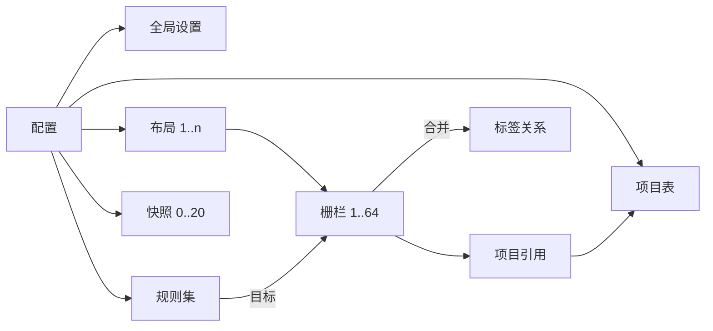

# PecoFence 产品需求文档

| 项目 | 内容 |
|---|---|
| 产品 | PecoFence |
| 文档版本 | 1.0 |
| 对应产品版本 | 0.2.3 |
| 平台 | Windows 10 22H2、Windows 11 22H2 及以上，x64 |
| 文档状态 | 基于当前实现整理，可直接评审 |
| 更新日期 | 2026-10-31 |
| 事实来源 | `README.md`、`docs/FEATURES.md`、`docs/CLI.md`、`docs/THEMES.md`、`docs/LOCALIZATION.md`、`docs/PORTABLE.md`、`docs/INSTALLER.md`、`docs/STORE.md` 及 `crates/` 下实现 |
| 许可 | Apache-2.0 |

## 0. 文档说明

本文描述 PecoFence **对用户可见的产品行为**，不描述实现方式。需求以当前源码与上述文档为准；当本文与实现不一致时，以实现为准并应修订本文。

- 标记 `[Assumption, TBD]` 的内容是根据现有实现推断、但缺少产品确认的假设。
- 标记 `[TBD]` 的内容是当前没有依据、需要产品决策的开放问题。
- 优先级含义：**P0** 为完成「桌面收纳」核心闭环与数据/图标安全所必需；**P1** 为提升效率、个性化与协作能力的增强能力。本版本两类能力均已交付，优先级用于后续取舍，不代表发布顺序。
- 本文不写验收标准、排期、人力与营销计划；可验证的行为写在每条需求的「可观察结果」中。

## 1. 产品定位

### 1.1 一句话描述

PecoFence 是开源的 Windows 桌面收纳工具：把桌面图标放进可自由摆放的玻璃栅栏，用标签页组织多组工作区，用规则自动归类新文件，并允许用户通过内置 CLI 让 AI 助手直接配置桌面。

### 1.2 背景与要解决的问题

Windows 桌面的图标平铺在同一平面上，文件一多就会出现以下问题：

1. **找不到**：项目、临时文件、截图、文档混在一起，缺少稳定的空间分区。
2. **不敢整理**：手动建文件夹会改变文件真实位置，打乱用户已有的使用习惯。
3. **重复劳动**：新下载的文件每次都要手动拖到对应位置。
4. **切换成本高**：不同项目需要不同的图标集合，但桌面只有一层。
5. **配置门槛高**：主题、透明度、规则等选项分散，批量调整依赖重复点击。

PecoFence 用「虚拟归属 + 玻璃栅栏」解决前四项：整理只改变图标显示在哪个栅栏，不移动、不修改真实文件；需要真实移动时，走与资源管理器一致的文件操作。第五项由内置 CLI 与 AI 助手协作解决。

### 1.3 产品目标

| 目标 | 可观察的结果 |
|---|---|
| 桌面有稳定的空间结构 | 用户可创建、移动、缩放、锁定多个栅栏，重启后位置与内容保持 |
| 整理不伤害文件 | 虚拟栅栏之间的整理不改变真实文件；真实文件移动有系统对话框、进度与撤销 |
| 新文件自动归位 | 新桌面项目按规则进入对应栅栏，无需手动拖放 |
| 多工作区快速切换 | 多个栅栏可合并为标签页，随时切换、重排、拆出 |
| 桌面随时可用 | 收起、速览、快速隐藏、双击桌面隐藏等操作可快速让出屏幕 |
| 桌面可个性化 | 主题、透明度、色调、字体、圆角、图标样式按栅栏或全局调整 |
| 配置可被 AI/脚本驱动 | CLI 能读取并修改正在运行的实例，输出机器可读结果与稳定的错误码 |
| 出错可恢复 | 桌面图标可恢复；配置有原子写入、`.bak`、每日备份与快照 |

### 1.4 非目标

| 不做的事 | 说明 |
|---|---|
| 多页桌面（屏幕边缘滑动切换整页桌面） | 产品决定不做 |
| 桌面右键菜单中的「配置 PecoFence」 | 需要 Shell 扩展；用托盘菜单与桌面框选替代 |
| 云同步、账户体系、跨设备配置同步 | 当前无此能力 |
| 遥测与使用行为上报 | 产品明确不做；反馈由用户主动发送 |
| 读取其他窗口内容或视频壁纸做玻璃取样 | 玻璃只采样当前壁纸，避免隐私与性能问题 |
| 修改或替换资源管理器 | 文件操作、菜单、图标均调用系统能力 |

## 2. 用户与核心场景

### 2.1 目标用户

| 用户 | 主要诉求 |
|---|---|
| 知识工作者 / 开发者 | 桌面按项目分区，快速切换工作区，减少找文件的时间 |
| 游戏与多媒体用户 | 桌面图标不遮挡壁纸，栅栏可收起、半透明、可速览 |
| 喜欢定制桌面的用户 | 玻璃材质、色调、字体、圆角、图标着色可调 |
| AI 助手 / 自动化用户 | 通过 CLI 批量配置、整理、备份，并得到结构化结果 |
| 从 Stardock Fences 迁移的用户 | 获得相近的栅栏、标签页、规则、快照体验，且开源、免费 |

### 2.2 核心任务闭环

- **触发**：用户启动 PecoFence，首次进入或已有配置。
- **核心任务**：把桌面图标分区收纳，并让新文件自动进入正确分区。
- **完成条件**：桌面图标被隐藏并由栅栏呈现；至少一个栅栏可正常打开项目；新桌面文件按规则落到栅栏；退出后真实桌面图标恢复。
- **恢复路径**：配置损坏时从 `.bak` / 每日备份 / 默认配置回退；异常退出后桌面图标由 watchdog 恢复；误操作可撤销或从快照恢复。

### 2.3 典型场景

| 场景 | 用户动作 | 产品结果 |
|---|---|---|
| 首次使用 | 启动应用 | 自动建立「程序」「文件夹」「文件与文档」「桌面」四栏并按预设规则归类 |
| 日常下载 | 浏览器把文件下载到桌面 | 规则命中后进入目标栅栏；未命中留在「桌面」栏 |
| 项目切换 | 把两个栅栏合并为标签页 | 一个窗口内切换项目与资料，标签可拖出恢复独立窗口 |
| 临时让出屏幕 | 双击桌面空白处 | 所有栅栏淡出；再次双击恢复 |
| 从其他应用取文件 | 按 `Ctrl+Alt+Space` 速览 | 栅栏浮到当前应用之上，取完文件后 `Esc` 返回 |
| 用 AI 调整外观 | 让助手运行 `pecofence-cli` | 读取现状、备份配置、批量修改主题与透明度，返回 JSON 变更结果 |
| 换显示器 | 插拔显示器或改分辨率 | 按显示器组合加载对应布局，栅栏自动重排 |
| 桌面图标异常 | 托盘「修复桌面图标」或设置页恢复 | Windows 桌面图标重新显示 |

## 3. 版本范围与优先级

| 范围 | 包含 | 优先级 |
|---|---|---|
| 桌面收纳核心 | 栅栏创建/移动/缩放/锁定/删除/收起、图标视图、项目打开与拖放、托盘、真实桌面图标接管与恢复、配置持久化 | P0 |
| 自动化与安全 | 自动整理规则、手动放置优先、每日备份、快照、配置导入导出、崩溃恢复 | P0 |
| 多工作区与文件夹 | 标签页、文件夹门户、门户内导航、普通栅栏内打开文件夹 | P1 |
| 效率与呈现 | 速览与速览内搜索、详情/列表视图、滚动与排序、动效、主题与自定义主题、图标样式 | P1 |
| 外部驱动 | `pecofence-cli`、`describe`/`skill`、事件流、配置校验、离线命令 | P1 |
| 产品化能力 | 11 种语言、设置页、反馈、更新检查、三种分发形态、自动启动 | P1 |

### 3.1 明确排除

见 [1.4 非目标](#14-非目标)。除表中两项外，当前版本不提供多页桌面与 Shell 右键扩展。

## 4. 术语与产品模型

### 4.1 术语

| 术语 | 定义 |
|---|---|
| **栅栏（Fence）** | 桌面上承载一组图标的玻璃窗口，有标题、位置、大小、视图与外观选项 |
| **「桌面」栏（Inbox）** | 每个布局中唯一的系统栅栏，收纳未归类或未命中规则的项目；不可删除 |
| **门户（Folder Portal）** | 直接显示某个真实文件夹内容的栅栏，内容随文件夹实时变化 |
| **标签页（Tab）** | 被合并进另一个栅栏窗口的栅栏；被合并者不再拥有独立窗口，但保留自己的项目、视图与外观 |
| **宿主（Host）** | 当前拥有窗口并承载标签页的栅栏 |
| **项目（Item）** | 桌面上的一个图标，可能是文件、文件夹、快捷方式或系统命名空间对象 |
| **布局（Layout）** | 一组显示器组合下所有栅栏的位置、大小与状态；不同显示器组合各有布局，但共享同一组栅栏与项目 |
| **快照（Snapshot）** | 用户命名保存的全部布局副本，可恢复；上限 20 个 |
| **规则（Rule）** | 一组「全部满足」的条件与目标栅栏，按顺序匹配新桌面项目 |
| **速览（Peek）** | 用快捷键把所有栅栏临时浮到其他窗口之上，并可压暗背景 |
| **DIP** | 设备无关像素，用于跨 DPI 的尺寸与间距描述 |
| **工作区（Work Area）** | 显示器去掉任务栏等保留区域后的可用矩形 |

### 4.2 对象关系

- 全局设置、规则、项目表与快照**跨布局共享**；布局只决定当前显示器组合下栅栏的几何与显示状态。
- 一个项目在任一时刻只属于一个栅栏；切换布局时项目归属不变。
- 一个标签页在任一时刻只属于一个宿主；宿主自身也可以作为标签存在。

### 4.3 对象状态

| 对象 | 状态 | 说明 |
|---|---|---|
| 栅栏 | 展开 / 收起 | 收起只保留标题行（左侧标签栏模式只保留标签列） |
| 栅栏 | 锁定 / 未锁定 | 锁定后边框不再响应缩放，标题仍可点击与右键 |
| 栅栏 | 显示 / 快速隐藏 / 速览浮起 / Win+D 隐藏 | 由全局开关与单栏排除项共同决定 |
| 栅栏 | 停靠 / 未停靠 | 停靠 = 贴顶 + 收起 + 悬停展开 |
| 栅栏 | 独立 / 作为标签 | 作为标签时无独立窗口，几何保留供拆出 |
| 「桌面」栏 | 可见 / 空时隐藏 / 显示真实图标时隐藏 | 作为标签或带标签时不隐藏 |
| 门户 | 根目录 / 子目录 | 子目录可逐级返回；文件夹被删除后自动回根 |
| 项目 | 已归类 / 未归类 | 未归类只存在于「桌面」栏或 Windows 桌面 |
| 项目 | 选中 / 焦点 | 选中可多选；焦点项单独显示焦点环 |
| 规则 | 启用 / 停用 | 停用规则不参与匹配，也不回收已归类的项目 |
| 快照 | 用户快照 / 自动快照 | 自动快照用于恢复前保护，数量受限 |

## 5. 功能需求

每个模块先说明目的与入口，再列出可验证的产品行为。跨模块共用的规则集中在 [6. 共享业务规则](#6-共享业务规则)。

### 5.1 首次启动与基础运行（FR-ONB）

**目的**：让用户第一次打开就得到可用的桌面结构，并且随时能安全退出。

**入口**：启动 `pecofence.exe`、登录自动启动、托盘图标。

| ID | 优先级 | 需求 | 可观察结果 / 规则 |
|---|---|---|---|
| FR-ONB-01 | P0 | 首次启动自动创建四栏 | 建立「程序」「文件夹」「文件与文档」「桌面」四栏，按内置预设规则把现有桌面项目归入前三栏，其余进入「桌面」栏 |
| FR-ONB-02 | P0 | 整理不改变真实文件 | 首次归类只改变图标归属，不移动、不重命名、不修改任何真实文件 |
| FR-ONB-03 | P0 | 首次启动语言 | 默认跟随 Windows 显示语言；无对应语言时回退英语；用户可随时切换 |
| FR-ONB-04 | P0 | 单实例运行 | 同一 Windows 账户默认只运行一个实例；再次启动不会产生第二套栅栏与图标接管 |
| FR-ONB-05 | P0 | 托盘常驻 | 关闭设置窗口或栅栏不退出应用；托盘菜单提供显示/隐藏、新建栅栏、文件夹门户、设置、反馈、退出等入口 |
| FR-ONB-06 | P0 | 真实桌面图标接管 | 默认隐藏 Windows 桌面图标，由栅栏呈现；退出时恢复；异常退出由 watchdog 兜底（见 FR-SEC）；**启动时窗口框架与基础栅栏先行呈现，桌面原生图标隐藏延迟至主交互就绪后异步执行（默认延迟 1.5–2.5 s）**，避开登录瞬间 Explorer 高负载；退出与异常恢复机制保持不变 |
| FR-ONB-07 | P1 | 出现异常时可继续使用 | 上次崩溃后启动给出提示，用户可直接打开反馈页；日志与崩溃转储保留供诊断 |
| FR-ONB-08 | P1 | 自动启动可选 | 默认随 Windows 启动；只登记正式版路径；便携模式不修改系统启动项 |
| FR-ONB-09 | P0 | 渐进式骨架首屏上屏 | 启动后立即以轻量基础纯色 / 低阶半透明材质展示栅栏轮廓与文字，图标区域显示占位块；壁纸折射与高阶毛玻璃材质在后台 worker 就绪后，以 167 ms 平滑交叉淡入替换，杜绝启动白屏或无响应等待 |
| FR-ONB-10 | P1 | 开机静默抑流模式 | 随系统启动运行的前 30 s 内，自动进入「开机静默模式」：关闭高频磁盘探测，将文件变化响应合并窗口从正常 60 ms 放宽至 1000 ms，并临时丢弃 `.tmp`、`.crdownload` 等未持久化临时文件事件，防止开机自启程序在桌面上写盘风暴引起界面抖动与持续重绘 |

**异常与边界**

- 显示器初始化失败或没有可用工作区时，不隐藏真实桌面图标，避免用户无桌面可用。
  `[Assumption, TBD]` 具体失败分支以当前实现为准，产品需确认是否应在该情况下自动关闭「隐藏桌面图标」。
- 第二个实例启动时若已有实例运行，应把焦点交给现有实例或安静退出，不重复接管桌面。
- 若 Worker 无法获得壁纸（GPU 忙、显卡驱动刚启动），栅栏以纯色背景呈现，不得因等待壁纸阻塞首屏；壁纸稍后就绪时平滑切换。
- 桌面图标隐藏延迟期间若用户主动切换设置或注销，当前正在请求的隐藏应被安全取消。

### 5.2 栅栏基础（FR-FNC）

**目的**：提供可自由布局、可收起、可多选的桌面容器。

**入口**：桌面空白处拖拽、托盘菜单、栅栏菜单、栅栏标题栏、设置页。

| ID | 优先级 | 需求 | 可观察结果 / 规则 |
|---|---|---|---|
| FR-FNC-01 | P0 | 新建栅栏 | 在空桌面拖出**不碰到任何栅栏**的矩形，出现「在此新建栅栏」；托盘/栅栏菜单也可新建。新栏落在源栏旁的空位，宽度为整数列；点菜单外或按 `Esc` 取消 |
| FR-FNC-02 | P0 | 可关闭拖拽新建 | 设置关闭「在桌面空白处拖出矩形时提供新建栅栏」后，拖拽只用于框选，不出现新建入口 |
| FR-FNC-03 | P0 | 框选多个栅栏 | 拖拽矩形碰到的栅栏实时高亮并被选中；`Ctrl`/`Shift` 追加；锁定栅栏不参与；选中栅栏有白色描边；单击桌面、单击任一栅栏或 `Esc` 取消 |
| FR-FNC-04 | P0 | 移动栅栏 | 拖标题栏移动；拖动选中组中任一标题栏则整组移动；与其他栅栏、屏幕边缘、屏幕中线吸附（默认间距 8 px）；按住 `Alt` 自由移动；`Esc`/右键取消时整组回原位；松手后与其他栅栏重叠的成员各自移到最近空位 |
| FR-FNC-05 | P0 | 缩放栅栏 | 拖边缘/角；拖动的边吸附到其他栅栏的边与屏幕边缘并显示参考线；`Alt` 不吸附；开启「按整行整列对齐」后宽度按整列、高度按整行；列表/详细信息视图宽度不受列限制；收起时只可改宽 |
| FR-FNC-06 | P0 | 自动高度 | 开启后高度跟随内容行数；内容增减时底边 250 ms 过渡（阴影同步）；启动与手动拖改不动画 |
| FR-FNC-07 | P0 | 锁定 | 锁定后边框不再是缩放区，标题仍可点击、右键、双击 |
| FR-FNC-08 | P0 | 重命名栅栏 | 内嵌编辑框；`Enter` 确定、`Esc` 取消；`F2` 只重命名选中图标，不重命名栅栏 |
| FR-FNC-09 | P0 | 删除栅栏 | 菜单删除后，栏内项目回到「桌面」栏；「桌面」栏不可删除；删除是持久操作，栅栏相关规则目标一并移除 |
| FR-FNC-10 | P1 | 桌面栏空时自动隐藏 | 「桌面」栏为空时淡出；新项目落到桌面时在原位置重新出现；作为标签或带标签时不隐藏 |
| FR-FNC-11 | P1 | 显示真实图标时隐藏桌面栏 | 关闭「隐藏 Windows 桌面图标」后，可让「桌面」栏不显示窗口；未归类项目只出现在 Windows 桌面上；重新隐藏真实图标后恢复；作为标签或带标签时不隐藏 |
| FR-FNC-12 | P1 | 收起 / 展开 | 双击标题、菜单、右侧折叠箭头均可；展开 333 ms / 收起 167 ms；内容 83 ms 交叉淡入淡出；折叠箭头同步旋转；收起后标题右侧显示项目数 |
| FR-FNC-13 | P1 | 收起样式可选 | 可隐藏标题右侧项目数与折叠箭头，只显示名称；点击标题、双击与菜单仍可展开 |
| FR-FNC-14 | P1 | 悬停展开 / 点击展开 | 收起栅栏悬停系统悬停时长（默认 400 ms）后展开；可改为必须点击标题展开，此时仍可拖动 |
| FR-FNC-15 | P1 | 拖文件到收起标题也展开 | 拖动文件在收起标题上停留同样时长后展开；松手或离开后收起 |
| FR-FNC-16 | P1 | 推开下方栅栏 | 展开时，同一屏幕、左右重叠且位于标题行下方的栅栏逐帧下移，保留原间距；收起后滑回；不移动保存的位置；不超出工作区；锁定或正在拖动的栅栏不动 |
| FR-FNC-17 | P1 | 悬停才显示标题栏 | 全局或单栏设置；平时标题行整行收起，玻璃从图标区开始；指针进入时玻璃顶边 167 ms 伸回、标题 83 ms 淡入，图标位置不变；收起、合并悬停、重命名标题时保持显示 |
| FR-FNC-18 | P1 | 停靠屏幕顶部 | 栅栏贴顶、收起、悬停展开 |
| FR-FNC-19 | P0 | 快速隐藏 / 显示 | 双击桌面空白处隐藏全部栅栏，再双击显示；托盘菜单与双击托盘图标等效；第二击松开即切换，拖出框选则取消；栅栏 167 ms 线性淡出/淡入，阴影同步 |
| FR-FNC-20 | P1 | 单栏排除快速隐藏 | 栅栏选项「双击桌面隐藏时保留此栅栏」后，该栏不参与快速隐藏 |
| FR-FNC-21 | P1 | Win+D 行为 | 选择「保持栅栏可见」或「随桌面隐藏」；后者与 Windows 显示桌面一致 |
| FR-FNC-22 | P1 | 自动隐藏滚动条 | 鼠标在栏内、滚动后或离开后 2 s 内显示；83 ms 淡入淡出 |
| FR-FNC-23 | P0 | 多显示器独立布局 | 每个显示器组合保存独立布局；分辨率、缩放、任务栏变化后自动重排；不同布局共享同一组栅栏与项目 |
| FR-FNC-24 | P0 | 高 DPI | 按每显示器 DPI 渲染；登录时 96 DPI 漂移自动修正，栅栏不因 DPI 变化错位 |

**异常与边界**

- 新建矩形碰到栅栏时，不进入新建流程，而进入框选流程；锁定栅栏不进入选择集。
- 栅栏移动/缩放进入非法区域（完全离开工作区）时，应被拉回可见工作区。`[Assumption, TBD]` 具体回弹策略由实现决定，产品未在此规定。
- 显示器拔出后，相关窗口与栅栏应停止渲染；显示器重新接入时按指纹恢复布局。

### 5.3 视图与外观（FR-VIS）

**目的**：让栅栏在「找得到、看得清、符合个人审美」三个层面可用。

**入口**：栅栏菜单 → 视图、栅栏选项、设置 → 常规/颜色模式、CLI。

| ID | 优先级 | 需求 | 可观察结果 / 规则 |
|---|---|---|---|
| FR-VIS-01 | P0 | 图标大小 | 小/中/较大/大 = 32/48/64/96 px；`Ctrl+滚轮` 在图标视图中依次切换 32 → 48 → 64 → 96；设置可定新建栅栏默认值 |
| FR-VIS-02 | P1 | 图标间距 | 紧凑 / 标准 / 宽松 |
| FR-VIS-03 | P0 | 视图样式 | 图标 / 列表 / 详细信息；任何栅栏可用，不限门户 |
| FR-VIS-04 | P0 | 滚动 | 支持滚轮、方向键/PageUp/PageDown/Home/End/首字母跳选、轨道点击、箭头按住连续滚动；平滑滚动遵循 WinUI 节奏；连续滚轮从目标位置累加；滚轮步长跟随 Windows「每次滚动行数」；精密触控板亚格增量 1:1 跟手；拖动拇指或按住轨道时忽略其他滚动输入 |
| FR-VIS-05 | P1 | 悬浮滚动条 | 指针停在右侧 12 DIP 区域 0.4 s 后加宽至 6 DIP，并淡入轨道与箭头；离开 0.5 s 后收窄淡出；拇指最短 30 DIP；拖动或按住轨道立即加宽；系统关闭动画时不等延时 |
| FR-VIS-06 | P1 | 详细信息列 | 点击表头排序、再点倒序；拖分隔线改列宽，双击自动列宽；表头右键勾选修改日期/类型/大小、恢复默认列宽；列宽按栅栏保存；窄栏自动收起列 |
| FR-VIS-07 | P1 | 排序 | 手动 / 名称 / 类型 / 修改日期 / 大小 / 打开次数，可倒序；手动排序时可在栏内拖动图标调整顺序并显示插入标记 |
| FR-VIS-08 | P1 | 布局动效 | 新增/删除/重排/改排序时图标从旧格滑到新格（250 ms 点到点）；新项 167 ms 淡入；移除项 83 ms 淡出；切换标签、门户导航等大范围更换直接切换；跟随系统「动画效果」开关 |
| FR-VIS-09 | P1 | 图标载入 | 异步图标在灰色占位块上 167 ms 交叉淡入；缓存命中直接显示；改图标大小、切视图、跨缩放屏幕时旧图标先按新尺寸缩放显示，新图标取到后替换 |
| FR-VIS-10 | P1 | 选中项全名 | 选中项名称展开完整显示，最多 6 行，压在下一行之上；重命名编辑框打开时不展开 |
| FR-VIS-11 | P1 | 主题风格 | Fluent（壁纸毛玻璃）或 Liquid Glass（中心清透、边缘折射）；圆角分别为 8 / 16 DIP；阴影与边缘线沿同一圆弧；不采样其他窗口或视频壁纸 |
| FR-VIS-12 | P1 | 自定义主题 | 从配置的 `themes` 文件夹选择 JSON 主题；可设置基于 Fluent/Liquid Glass、模糊、色调、亮度混合、饱和度、噪点、折射、边缘高光、圆角、阴影、强调色、各颜色与字体；保存后栅栏立即更新；文件错误时保持内置风格并说明原因；内置三个示例主题 |
| FR-VIS-13 | P1 | 不透明度 | 更透明 / 默认 / 更厚实 / 全透明；Fluent 默认 55% 玻璃；Liquid Glass 默认完整折射；全透明时平时只显示图标与标题，指针进入/收起/浮现/拖放/合并时玻璃 167 ms 淡入 |
| FR-VIS-14 | P1 | 栅栏色调 | 9 色或无；可只给标题栏上色；标签页色条随之变化；只给标题栏上色时保留上圆角与下直边 |
| FR-VIS-15 | P1 | 标题颜色与字号 | 标题颜色：跟随主题/跟随色调/白/黑；字号：小/标准/大/特大 = 12/14/16/18 DIP；字号同时作用于标签文字，标题栏高度不变 |
| FR-VIS-16 | P1 | 标签页颜色 | 跟随栅栏色调或 9 色；每个标签文字下方色条使用自己的颜色，拆出/合并后保留 |
| FR-VIS-17 | P1 | 标题对齐 | 所有栅栏共用左/中/右对齐；居中按整个栅栏宽度，放不下时让开右侧折叠箭头区；标签条整体随之对齐 |
| FR-VIS-18 | P1 | 深浅色主题 | 跟随 Windows / 跟随应用 / 浅色 / 深色；与主题风格独立保存；系统切换实时跟随；菜单与托盘菜单随之变色 |
| FR-VIS-19 | P1 | 图标名称颜色 | 自动 / 白色 / 黑色；自动时 Liquid Glass 按壁纸明暗选择，Fluent 跟随颜色模式；衬光随文字配色 |
| FR-VIS-20 | P1 | 系统强调色 | 选中、框选、拖放高亮、插入标记、托盘图标与设置页品牌色取 Windows 个性化强调色，改色实时跟随 |
| FR-VIS-21 | P1 | 状态过渡 | 悬停/按下 83 ms；选中/悬停/焦点按项目身份跨排序、重排、重命名、文件夹刷新保留；激活立即显示强调色；关闭系统动画即瞬切；只重绘变化层 |
| FR-VIS-22 | P1 | 图标着色 / Chameleon | 可全局染色并调节强度；可让图标降饱和、降透明度以融入背景 |
| FR-VIS-23 | P1 | 快捷方式箭头 | 默认显示；对资源管理器标箭头的快捷方式在左下角绘制 Windows 原生箭头；所有视图与图标尺寸、缩放比例均生效；使用系统箭头图像 |

**异常与边界**

- 自定义主题不可读、JSON 语法错误、字体不存在或值越界时，不应用该主题，保持当前内置风格，并在设置页与日志中说明原因。
- 主题与颜色模式独立：切换深浅色不改变 Fluent/Liquid Glass 选择。
- 系统关闭「动画效果」时，所有动效直接跳到终态。

### 5.4 标签页栅栏（FR-TAB）

**目的**：把多个栅栏合并到一个窗口，减少桌面占用并支持工作区快速切换。

**入口**：拖动标题到另一栅栏标题、栅栏菜单 → 标签页、右键标签、拖标签。

| ID | 优先级 | 需求 | 可观察结果 / 规则 |
|---|---|---|---|
| FR-TAB-01 | P1 | 合并为标签页 | 拖动一个栅栏标题到另一栅栏标题上松手，目标标题高亮；或菜单「合并到…」；被合并栅栏成为目标窗口的一个标签，按指针槽位插入（过胶囊中线即下一格），拖过末尾则追加；`Esc` 取消不合并 |
| FR-TAB-02 | P1 | 标签栏位置 | 顶部或左侧，全局共用，默认顶部；左侧时有两个及以上标签才显示，行高 32 DIP，列宽 96–160 DIP 且最多占栅栏宽度 45%；左侧标签列代替标题行 |
| FR-TAB-03 | P1 | 顶部标签溢出 | 标签保持自身宽度（最宽 160 DIP），标签条横向滚动；切换标签时 167 ms 滚到完整露出当前标签；两端 12 DIP 渐隐；被挡住部分不响应点击 |
| FR-TAB-04 | P1 | 切换标签 | 点击标签、`Ctrl+Tab`/`Ctrl+Shift+Tab`、标题行滚轮、可选悬停切换；滚轮每格切换一个、到两端停止不循环；切换时旧内容 83 ms 淡出、新内容 83 ms 淡入并从新标签一侧滑入 24 DIP |
| FR-TAB-05 | P1 | 标签状态保留 | 每个标签在本次会话内保留自己的图标大小、视图、排序与滚动位置 |
| FR-TAB-06 | P1 | 重排标签 | 沿标签条拖动，越过邻居中线即交换，邻居 167 ms 滑入空位；右键标签可左移/右移（左侧模式为上移/下移）；顺序持久化；`Esc` 或右键取消并滑回 |
| FR-TAB-07 | P1 | 拆出标签 | 拖出标题行（上下 28 DIP 或拖出窗口；左侧模式向左右 28 DIP）即成为独立栅栏；新窗口出现在指针下并跟随鼠标；不松手拖回任一栅栏标题即重新合并；`Esc`/右键取消，标签回原位 |
| FR-TAB-08 | P1 | 新建标签页 | 栅栏菜单 → 新建 → 标签页，在当前窗口内加一个空栏 |
| FR-TAB-09 | P1 | 拖到标签头 | 文件或图标拖到某标签头即放入该标签；标签头以选中色 + 强调色边框高亮；停留不切换标签；拖到项目自身所在标签头显示禁止光标且不高亮 |
| FR-TAB-10 | P1 | 双击标签 | 收起/展开整个窗口 |
| FR-TAB-11 | P1 | 收起与标签的联动 | 收起时保留标题行/标签列；左侧模式收起后只剩标签列，高度刚好放下全部标签；宽度与高度一起动画 |
| FR-TAB-12 | P1 | 标签栏自动增高 | 标签放不下时（合并、新增、改名、切换设置），栅栏自动长高到下方栅栏或屏幕底边；自动高度栅栏始终把标签栏计入高度 |

**异常与边界**

- 标签作为宿主时无独立几何；CLI 对标签设置边界返回不支持，应操作宿主。
- 删除带标签的宿主 `[TBD]`：当前产品文档未定义标签如何重新分配，需产品确认；实现中拆出逻辑会选一个剩余标签接管窗口。
- 左侧标签栏与「悬停才显示标题栏」不叠加：左侧模式不受该设置影响。
- 只有两个标签时拆出其中一个，剩下一个成为独立栅栏。

### 5.5 文件夹门户（FR-POR）

**目的**：把真实文件夹放到桌面，实时浏览并支持真实文件操作。

**入口**：文件夹图标右键、托盘/栅栏菜单、`pecofence --portal <文件夹>`、CLI 创建门户。

| ID | 优先级 | 需求 | 可观察结果 / 规则 |
|---|---|---|---|
| FR-POR-01 | P1 | 创建门户 | 可对文档/下载/图片等常用文件夹或任意选择文件夹创建；实时跟随文件夹内容，含网络与云盘目录 |
| FR-POR-02 | P1 | 拖入门户 | 从桌面栏或资源管理器拖入即真实移动到该文件夹；跨盘默认复制，`Shift` 强制移动；`Ctrl` 复制、`Shift` 移动、`Alt` 或 `Ctrl+Shift` 创建快捷方式；只提供来源允许的效果 |
| FR-POR-03 | P1 | 右键拖入 | 松手弹出「移动 / 复制 / 创建快捷方式 / 取消」菜单，默认项加粗；`Esc` 取消；有进度、冲突对话框与撤销 |
| FR-POR-04 | P1 | 从门户拖出 | 拖到虚拟栅栏或桌面时真实移到桌面并进入目标栏 |
| FR-POR-05 | P1 | 门户内导航 | 双击子文件夹进入；标题前文件夹图标变为向上箭头，或标题左侧向上按钮、`Backspace`、`Alt+Up` 返回；菜单可返回上一级或最初文件夹；标题显示当前文件夹名；空文件夹显示「此文件夹为空。」 |
| FR-POR-06 | P1 | 导航动效 | 新文件夹从顶部显示，内容交叉淡入淡出；进入从右侧、返回从左侧滑入；返回上一级后选中并滚动到刚离开的文件夹 |
| FR-POR-07 | P1 | 双击文件夹行为 | 门户可设「在栅栏内打开」或「资源管理器打开」；门户中指向文件夹的快捷方式总用资源管理器打开 |
| FR-POR-08 | P1 | 普通栅栏内打开文件夹 | 普通栅栏与「桌面」栏可开启「双击文件夹或文件夹快捷方式时在此栅栏内打开」；运行时显示为该文件夹并像门户一样导航，重启后回到原图标；此状态下移动项目只改归属，不把桌面文件移入该文件夹 |
| FR-POR-09 | P1 | 标题栏文件夹图标 | 门户标题前可显示文件夹图标；合并成标签后标签名前也显示 |
| FR-POR-10 | P1 | 在资源管理器中打开 | 栅栏菜单可直接打开当前文件夹 |

**异常与边界**

- 子文件夹被删除、重命名或移动后，门户自动回根或跟随新路径；不可访问时显示错误状态 `[Assumption, TBD]`。
- 文件移动冲突：虚拟栅栏间移动不产生冲突；真实移动遇到同名文件由系统冲突对话框处理；CLI 批量移动遇到同名文件跳过并返回警告，不弹替换对话框。
- 网络/云盘目录不可用时，错误由系统文件操作呈现；门户不应阻塞 UI。

### 5.6 项目操作（FR-ITM）

**目的**：让栅栏内的图标拥有与资源管理器一致的操作能力。

**入口**：双击/Enter、右键项目菜单、键盘、拖放。

| ID | 优先级 | 需求 | 可观察结果 / 规则 |
|---|---|---|---|
| FR-ITM-01 | P0 | 打开项目 | 双击或 `Enter` 打开；门户内文件夹按 FR-POR-05 导航或打开；普通栅栏内文件夹默认用资源管理器打开；多选后打开时文件夹一律用资源管理器 |
| FR-ITM-02 | P1 | QuickLook 预览 | 已安装并运行 QuickLook 时，选中图标按空格预览焦点项，再按空格关闭；预览中方向键移动即预览新焦点；`Esc` 关闭；未运行 QuickLook 时空格无动作 |
| FR-ITM-03 | P0 | 选择 | 单击、`Ctrl` 多选、`Shift` 范围、框选、`Ctrl+A`、方向键/Home/End/PageUp/PageDown、首字母跳选；框选越界逐帧自动滚动；`Ctrl+方向键`/`Ctrl+Home/End` 只移焦点不改选择；`Ctrl+空格` 切换焦点项；多选后单击其一收缩为单选 |
| FR-ITM-04 | P0 | 栅栏间移动 | 拖到另一栅栏或标签头；项目菜单「移动到栅栏」；拖回空桌面 = 放回「桌面」栏且不再按规则归类；虚拟栏之间只改归属，不动文件；拖到内容区上下边缘时自动滚动 |
| FR-ITM-05 | P1 | 拖出到其他程序 | 拖到资源管理器、回收站、浏览器、其他程序；小选区（≤4 项且外接框 ≤320×320 DIP）使用图标排布位图拖影；更大选区使用系统缩略图堆叠 + 数量角标；源图标不变暗；显示移动/复制/链接光标；`Esc` 取消 |
| FR-ITM-06 | P1 | 拖到文件夹图标 | 拖到栏内文件夹图标上即移入该文件夹，支持复制/移动/创建快捷方式；文件夹高亮；拖影显示「移动到/复制到/在…中创建链接」角标 |
| FR-ITM-07 | P0 | 从外部拖入 | 从资源管理器或其他程序拖入，移到桌面并放入该栏；`Ctrl` 复制、`Shift` 移动、`Alt` 或 `Ctrl+Shift` 创建快捷方式；浏览器链接生成 `.url`；整栏强调色淡染 + 2 px 内环；拖影角标随目标与修饰键变化 |
| FR-ITM-08 | P1 | 右键拖放 | 从外部或门户右键拖入，松手弹出「移动到当前位置 / 复制到当前位置 / 在当前位置创建快捷方式 / 取消」，默认项加粗；`Esc` 不改变文件 |
| FR-ITM-09 | P0 | 重命名 | `F2`、项目菜单、再点名称；只选中主文件名，保留扩展名；重命名真实文件，命名冲突时拒绝 |
| FR-ITM-10 | P0 | 删除 | `Delete` 到回收站；`Shift+Delete` 永久删除；走系统删除对话框 |
| FR-ITM-11 | P1 | 剪贴板 | `Ctrl+C`/`Ctrl+X`/`Ctrl+V` 与资源管理器互通；剪切项半透明 |
| FR-ITM-12 | P1 | 新建 | 栅栏菜单 → 新建 → 文件夹/文本文档；`Ctrl+Shift+N` 新建文件夹；文件直接落入该栏并进入改名 |
| FR-ITM-13 | P1 | 属性与定位 | `Alt+Enter` 或项目菜单打开属性；项目菜单「打开文件所在位置」 |
| FR-ITM-14 | P1 | 资源管理器菜单 | 项目菜单下半部分使用原生 Shell 菜单，含发送到、复制、固定、第三方扩展；`Shift` 右键显示扩展项；菜单键/`Shift+F10` 打开 |
| FR-ITM-15 | P1 | 刷新 | `F5` 重读图标与内容 |
| FR-ITM-16 | P1 | 提示气泡 | 悬停截断名称、压缩标签、向上按钮时，指针静止满系统悬停时间后出现；滚动条热区不弹；系统消息时长后自动消失；主题/DPI 变化后重建 |
| FR-ITM-17 | P1 | 缩略图 | 图片/视频显示缩略图；文件夹在图标视图显示内容预览；列表/详细信息显示普通文件夹图标；系统开启「始终显示图标」时只显示普通图标；提取失败按 0.4/1.5/4 s 重试三次后显示文档字形；`.url` 从 IconFile 取图标 |

**异常与边界**

- 拖放到项目自身所在位置（同目录）时显示禁止光标，不执行操作。
- 移动/复制目标已存在同名文件时，由系统冲突对话框或系统规则决定；虚拟归属操作不应产生文件冲突。
- 系统命名空间对象（此电脑、回收站等）不支持重命名、移入门户或「打开所在位置」，应返回不可用状态。
- 真实文件操作在后台执行，不得阻塞栅栏动画与输入。

### 5.7 自动整理规则（FR-RUL）

**目的**：让新桌面项目自动进入正确栅栏，同时尊重用户的手动整理。

**入口**：设置 → 整理规则；托盘菜单「立即应用」；CLI `rule` 命令。

| ID | 优先级 | 需求 | 可观察结果 / 规则 |
|---|---|---|---|
| FR-RUL-01 | P0 | 新项目自动归类 | 新项目出现在桌面时按规则顺序匹配，首条命中生效；未命中进入「桌面」栏 |
| FR-RUL-02 | P0 | 条件类型 | 文件类型（程序/快捷方式/文件夹/文档/图片/音乐/视频/压缩包）、扩展名、名称包含/不包含/开头/结尾/恰好是、通配符、快捷方式目标包含、创建时间段、创建星期几、大小范围、仅文件夹/仅文件、普通文件 |
| FR-RUL-03 | P0 | 条件组合 | 一条规则的所有条件必须同时满足（AND）；快捷方式目标类规则优先评估 |
| FR-RUL-04 | P0 | 手动放置优先 | 用户手动拖入的项目不再被规则搬走；手动移动优先于后续自动归类 |
| FR-RUL-05 | P0 | 立即应用 | 设置「立即应用」、托盘菜单或 CLI `rule apply` 重新归类当前项目；`--dry-run` 只列出将发生的移动，不改变状态 |
| FR-RUL-06 | P0 | 未命中处理 | 可选「回到桌面栏」（默认）或「留在当前栅栏」；选后者时，已在栅栏中但不符合任何规则的项目留在原处；停用规则不会把已归类项目送回「桌面」栏；新项目仍进「桌面」栏 |
| FR-RUL-07 | P1 | 规则管理 | 设置页可启用/禁用、上下移动、删除；新增规则排在最前，「普通文件」规则排在最后；规则目标不能是门户 |
| FR-RUL-08 | P1 | 内置预设 | 首次启动内置「程序与快捷方式」「文件夹」「文件与文档」三条规则 |
| FR-RUL-09 | P1 | 不参与归类的对象 | 临时文件、系统项、`desktop.ini` 等不属于普通项目，不参与规则匹配；系统命名空间对象不被规则移动 |

**异常与边界**

- 规则目标栅栏被删除时，相关规则目标失效；需在删除时移除或重新指向「桌面」栏。
- 规则循环/目标为门户/空条件规则应被拒绝或校验失败（CLI 与设置页均需给出一致错误）。
- 批量应用规则时若移动 ≥20 个桌面项目，系统自动保存布局快照，避免不可逆的大规模变化。

### 5.8 布局、备份与设置（FR-BKP）

**目的**：让用户可以保存、恢复、迁移与备份自己的桌面方案。

**入口**：设置 → 布局与备份 / 关于；托盘；CLI。

| ID | 优先级 | 需求 | 可观察结果 / 规则 |
|---|---|---|---|
| FR-BKP-01 | P0 | 布局快照 | 可命名保存当前全部布局；最多 20 个，满时需先删除；恢复前自动保存当前布局；恢复只影响布局，不改变全局设置、规则或真实文件 |
| FR-BKP-02 | P1 | 自动快照 | 恢复、导入、删除栅栏、应用规则等破坏性操作前自动保存；自动快照达到上限时只替换最早的自动快照，不挤占用户快照 |
| FR-BKP-03 | P0 | 每日备份 | 自动保留 7 天备份，另有 `config.bak`；设置页可一键恢复 |
| FR-BKP-04 | P1 | 导出 / 导入配置 | 导出完整配置为 JSON；导入前自动保存快照；导入后设置、规则、布局与快照一并恢复 |
| FR-BKP-05 | P1 | 交换显示器内容 | 两个显示器上的栅栏互换位置与内容 |
| FR-BKP-06 | P0 | 桌面文件夹迁移 | 桌面移到 OneDrive 或其他盘后，记录自动跟随；桌面盘不可用时不丢记录 |
| FR-BKP-07 | P1 | 配置文件可发现 | 配置位于 `%APPDATA%\PecoFence\config.json`；设置 → 关于可直接打开；文件首行 `$schema` 指向公开 Schema；`--portable` 时位于 exe 旁 |
| FR-BKP-08 | P1 | 设置页按需加载 | 设置窗口只在打开时创建，关闭后销毁；未打开时没有 WebView2 常驻开销 |
| FR-BKP-09 | P1 | 设置结构 | 至少覆盖常规、外观/颜色、栅栏选项、整理规则、布局与备份、关于；单栏外观也可从栅栏菜单直达 |
| FR-BKP-10 | P1 | 自动启动 | 设置可开关；只登记正式版路径；便携模式不修改系统启动项 |

**异常与边界**

- 配置文件不可读或字段非法时：先隔离不可读文件，依次回退 `.bak`、最近每日备份、默认配置；用户数据不应被静默丢弃。
- 保存失败（磁盘满、权限、跨设备）时，应用继续运行并提示保存失败，不应让界面状态与磁盘状态无声分叉。
- 快照不包含全局设置与规则；需要备份设置/规则时使用配置导出。

### 5.9 速览与速览内搜索（FR-PEK）

**目的**：在不切换窗口的情况下，从任意应用临时访问桌面栅栏。

**入口**：全局快捷键（默认 `Ctrl+Alt+Space`）、托盘菜单「速览所有栅栏」、CLI `peek`。

| ID | 优先级 | 需求 | 可观察结果 / 规则 |
|---|---|---|---|
| FR-PEK-01 | P1 | 速览浮起 | 所有栅栏浮到当前窗口之上；可压暗背景（30% 黑，83 ms 淡入/淡出）；再次按热键、`Esc`、点击空处、切换窗口或打开文件结束 |
| FR-PEK-02 | P1 | 热键可配置 | 可录制任意组合，必须含 `Ctrl`、`Alt` 或 `Win`；「包含 Win 键」补上被 Windows 先截走的 Win；立即试注册；被占用或属于系统常用快捷键时拒绝 |
| FR-PEK-03 | P1 | 热键回退 | 配置组合被占用时依次回退 `Ctrl+Alt+Space`、`Win+Alt+Space` 并提示；设置页显示实际生效的组合；不使用 `Ctrl+Shift+Space` 作为回退 |
| FR-PEK-04 | P1 | 速览内搜索 | 速览时直接打字，鼠标所在屏幕中间偏上出现搜索框；按名称或含扩展名的文件名匹配，不区分大小写；匹配项选中色高亮，其余淡至 15% |
| FR-PEK-05 | P1 | 搜索导航 | 搜索框显示当前第几个/共几个或「没有匹配的文件」；`↑`/`↓` 切换并滚动到可见；`Enter` 打开并结束速览（文件夹用资源管理器打开）；`Esc` 结束速览 |
| FR-PEK-06 | P1 | 搜索临时展开 | 收起栅栏有匹配时临时展开；匹配在别的标签页时临时切换过去；速览结束后恢复原状；有匹配的标签显示匹配数徽标，无匹配标签变淡 |
| FR-PEK-07 | P1 | 多显示器 | 速览覆盖所有显示器；搜索框出现在指针所在显示器 |

**异常与边界**

- 速览期间拖动文件仍可把项目拖出；点击外部或切换前台应用应可靠结束速览，不残留压暗层。
- 热键注册失败时不能静默失效：至少通过设置页/提示告知用户实际生效组合。
- 速览不修改栅栏保存的展开/标签状态，结束后必须恢复。

### 5.10 AI 与命令行（FR-CLI）

**目的**：让脚本与 AI 助手读取并修改正在运行的 PecoFence，而不需要 GUI 自动化。

**入口**：`pecofence-cli.exe`、Microsoft Store 版 PATH 别名、便携版完整路径。

| ID | 优先级 | 需求 | 可观察结果 / 规则 |
|---|---|---|---|
| FR-CLI-01 | P1 | 连接运行实例 | CLI 驱动当前 Windows 账户正在运行的实例；不同账户各用各的通道；未运行时返回「未运行」错误 |
| FR-CLI-02 | P1 | 读取能力 | 状态与版本、显示器、栅栏列表/详情、项目列表与元数据、全局设置、规则、快照、备份列表 |
| FR-CLI-03 | P1 | 修改能力 | 创建/删除/重命名栅栏、设置边界与单栏选项、适配高度、收起/展开、停靠、合并/拆出标签、移动项目、重命名项目、修改设置、增删改启停规则、应用规则、保存/恢复/删除快照、导入/导出配置、启动/结束速览 |
| FR-CLI-04 | P1 | 选择器 | 栅栏与规则目标可用完整 UUID、≥6 位唯一前缀或标题；标题先精确匹配，再唯一不区分大小写子串；`inbox` 任意大小写始终指「桌面」栏 |
| FR-CLI-05 | P1 | 结构化输出 | 结果为 JSON，含 `ok`、`result`、`error`、`warning`；修改操作返回 `changed`，已符合目标状态时为 `false`；警告与结果同时呈现 |
| FR-CLI-06 | P1 | 稳定退出码 | `0` 成功、`1` 应用错误、`2` 用法错误、`3` 未运行、`4` 超时；错误码为稳定机器可读类别 |
| FR-CLI-07 | P1 | 超时不重复执行 | 默认等待 15 s；超时后应用丢弃未执行的请求，用户/AI 可先读状态再决定是否重试 |
| FR-CLI-08 | P1 | 破坏性操作保护 | 删除栅栏、应用规则（有变动）、一次移动 ≥20 个桌面项目、恢复快照前自动保存布局快照；达到 20 个快照上限时返回警告，不挤占用户快照 |
| FR-CLI-09 | P1 | 干跑与预览 | `item move --dry-run` 逐项预览（仅换栅栏/真实移动及目标/跳过原因）；`rule apply --dry-run` 只列出移动；重名文件真实移动时跳过而不弹替换对话框 |
| FR-CLI-10 | P1 | 事件流 | 可订阅项目新增/移除/移动、栅栏创建/删除/修改；每 500 ms 发送差分，30 s 心跳；最多 4 条事件流 |
| FR-CLI-11 | P1 | AI 可发现 | `describe` 输出命令目录与 JSON Schema；`skill` 输出给 AI 的 SKILL.md；`--fields` 只保留字段；`--ascii` 以 `\uXXXX` 输出非 ASCII |
| FR-CLI-12 | P1 | 离线命令 | `config check` 校验配置文件（规则目标、门户路径、标签宿主、`$schema`）；`paths` 列出配置/备份/日志/崩溃转储；`log -f` 跟随日志；无需运行实例 |
| FR-CLI-13 | P1 | 并发限制 | 同时最多 8 个连接；超出时返回忙碌；请求大小上限 1 MB；名称/标题/快照名去除首尾空白后 1–256 字符 |

**异常与边界**

- CLI 不抢占 UI 线程的模态循环：应用处于菜单或文件对话框时可能超时，这是预期行为，错误码为超时而不是崩溃或重复执行。
- CLI 的配置导出/导入作用于完整配置；快照只作用于布局，二者不可互相替代。
- Store/便携版路径差异必须由 CLI 自身或用户明确提供，AI 不应猜测可执行文件位置。

### 5.11 设置、多语言、反馈与更新（FR-SET）

**目的**：让用户能发现并调整所有产品行为，并在出现问题时获得支持。

**入口**：托盘菜单 → 设置、栅栏菜单 → 栅栏选项、设置页关于/反馈、CLI `settings`。

| ID | 优先级 | 需求 | 可观察结果 / 规则 |
|---|---|---|---|
| FR-SET-01 | P1 | 多语言 | 支持简体中文、繁体中文、英语、日语、韩语、德语、法语、西班牙语、葡萄牙语（巴西）、俄语、意大利语，并可跟随 Windows；切换即时更新设置页、菜单与原生界面文字 |
| FR-SET-02 | P1 | 名称不翻译 | 切换语言后已有文件名、栅栏名、规则名与快照名保持不变；Windows 自带对话框和扩展菜单仍使用系统语言 |
| FR-SET-03 | P1 | 单栏选项入口 | 栅栏菜单 → 栅栏选项打开设置中的该栅栏页面；桌面上正在调整的栅栏显示白色选中描边，离开页面或关闭设置即消失 |
| FR-SET-04 | P1 | 反馈 | 设置/托盘/崩溃提示可打开反馈页；默认附带可分享日志 `pecofence.share.log`，发送前可查看；日志只含固定文字、数字与错误码 |
| FR-SET-05 | P1 | 反馈隐私 | 反馈由用户主动发送；服务端限流每分钟 3 条；IP 只用于限流，不保存；用户文本中的 `@`、`#123` 等会被清洗 |
| FR-SET-06 | P1 | 检查更新 | 仅点击按钮时访问 GitHub；安装版下载安装包后退出、安装、自动重开；ZIP 版或发布无安装包时打开下载页；Store 版不显示（由 Store 更新）；正式版不接收测试版 |
| FR-SET-07 | P1 | 日志与诊断 | 日志位于 `%LOCALAPPDATA%\PecoFence\pecofence.log`，上次运行保留为 `pecofence.prev.log`；`RUST_LOG` 控制级别；panic 与未处理异常写入日志并留下崩溃转储 |
| FR-SET-08 | P1 | 恢复桌面图标 | 设置 → 关于与托盘菜单提供「恢复显示桌面图标」/「修复桌面图标」应急入口 |
| FR-SET-09 | P1 | 高级启动参数 | 支持便携模式、跳过隐藏图标、强制浅/深色、打开设置、指定门户、指定壁纸、定时退出、输出统计与测试脚本；具体参数见附录 A |
| FR-SET-10 | P1 | 无遥测 | 除用户主动发送的反馈外，不上报使用数据；更新检查只在用户操作时发生 |

**异常与边界**

- WebView2 运行时缺失时，设置窗口无法打开；应用其余功能应继续可用，并提示安装运行时（Windows 11 通常自带）。
- 语言缺失或翻译键缺失时回退英语，不显示空白或原始键名。
- 反馈服务不可用时，页面提示发送失败，用户内容不应被静默丢弃（可复制/重试）。`[Assumption, TBD]` 重试与草稿保留策略需产品确认。

### 5.12 桌面图标接管与安全恢复（FR-SEC）

**目的**：隐藏真实桌面图标是本产品最敏感的操作，必须始终可恢复。

| ID | 优先级 | 需求 | 可观察结果 / 规则 |
|---|---|---|---|
| FR-SEC-01 | P0 | 接管前留痕 | 在隐藏 Windows 桌面图标前写入标记；应用正常退出、注销或关机时恢复；崩溃后由独立 watchdog 恢复 |
| FR-SEC-02 | P0 | 崩溃恢复 | watchdog 等待应用退出；若标记仍存在则重试最多 10 次恢复桌面图标；若有新实例接管则不处理 |
| FR-SEC-03 | P1 | 可选保持隐藏 | 「关闭 PecoFence 时保持 Windows 桌面图标隐藏」默认关；开启后正常退出/注销/关机保持隐藏，下次启动接管；关闭该功能或带 `--no-hide-icons` 启动时恢复显示 |
| FR-SEC-04 | P1 | 卸载恢复 | 安装版卸载时恢复桌面图标；Store 版卸载或便携版删除后不会自动恢复，需右键桌面 → 查看 → 显示桌面图标（文档需明确告知） |
| FR-SEC-05 | P0 | 手动恢复入口 | 用户可通过设置与托盘菜单随时强制恢复，不依赖正常退出流程 |
| FR-SEC-06 | P0 | 破坏性文件操作可恢复 | 删除走系统对话框（可进回收站）；真实移动/复制有进度、冲突处理与撤销；虚拟整理不触碰文件 |
| FR-SEC-07 | P1 | 本机访问边界 | 外部工具只能通过当前用户受限的本机通道访问应用；不接受远程网络控制 |
| FR-SEC-08 | P1 | 更新来源 | 更新只从官方发布渠道按 HTTPS 获取；安装包自行校验数据完整性；测试实例的更新地址仅允许本机回环 |

**异常与边界**

- 应用在隐藏图标期间被强制结束（任务管理器、断电）时，下次启动或 watchdog 必须优先恢复可用的桌面。
- 卸载/删除程序后标记文件仍可能存在，产品文档必须提供手动恢复路径。
- 用户同时运行多个实例时，只允许一个实例接管图标，避免引用计数错乱。

## 6. 共享业务规则

以下规则跨模块生效，功能章节不再重复。

### 6.1 坐标、尺寸与多显示器

- 用户看到的尺寸与间距以 DIP 表达；跨 DPI 时保持物理观感一致。
- 栅栏几何按显示器工作区归一化保存；显示器组合、分辨率或缩放变化时按指纹匹配布局并重排。
- 布局按「显示器集合 + 分辨率 + 缩放」区分；同一组显示器换分辨率或缩放视为另一套布局。
- 所有布局共享同一组栅栏、项目与标签关系；切换布局只换几何与显示状态。
- 显示器热插拔后等待显示设置稳定再布局，避免中间状态抖动。

### 6.2 吸附、框选与落点

- 默认吸附其他栅栏、屏幕边缘、屏幕中线，间距 8 px；`Alt` 临时关闭吸附。
- 吸附不累积，窗口始终跟随指针，不会因连续吸附产生漂移。
- 整组移动以组的外框吸附，组内相对位置不变；取消时整组回原位。
- 松手后与其他栅栏重叠的成员各自移到最近空位，不允许栅栏永久互相覆盖。
- 框选只选中被矩形碰到的未锁定栅栏；隐藏桌面图标时自绘选框。

### 6.3 归属性与真实文件

| 操作 | 是否改变真实文件 | 说明 |
|---|---|---|
| 栅栏之间拖动 / 「移动到栅栏」 | 否 | 只改变项目归属 |
| 拖回空桌面 | 否 | 放回「桌面」栏，不再按规则重新归类 |
| 拖入/拖出文件夹门户 | 是 | 真实移动/复制，遵循来源允许的效果 |
| 拖到普通栅栏内的文件夹图标 | 是 | 移入该文件夹 |
| 在门户或普通栅栏内新建/重命名/删除 | 是 | 走系统文件操作 |
| 自动整理规则 | 否 | 只改变归属，不移动文件 |
| 首次启动归类 | 否 | 只改变归属 |

### 6.4 桌面图标接管契约

1. 只有在应用具备可用的栅栏窗口与桌面锚定后才隐藏真实图标。
2. 隐藏前写入标记；标记是恢复的依据，不得在未恢复前删除。
3. 正常退出、注销、关机、卸载（安装版）路径都必须尝试恢复。
4. 崩溃路径由 watchdog 恢复；新实例接管后 watchdog 不重复恢复。
5. 「保持隐藏」是显式选择，默认关闭；开启后必须提供手动恢复入口。
6. 任何恢复入口都应幂等：桌面图标已显示时再次调用不产生副作用。

### 6.5 规则优先级

1. 仅启用规则参与匹配。
2. 快捷方式目标类规则优先于其他规则（稳定排序）。
3. 同一规则内所有条件为 AND。
4. 按规则顺序首条命中生效。
5. 手动放置的项目不被后续规则搬走。
6. 未命中项按全局「回桌面 / 留在原处」策略处理。
7. 规则只改变归属，不移动真实文件；目标不能是门户。

### 6.6 持久化、备份与恢复

- 主配置不可读时隔离保留，依次回退 `.bak`、最近每日备份、默认配置，并告知用户。
- 保存采用先写临时文件、刷盘、轮转 `.bak`、再替换主文件；跨设备无法原子替换时回退为原地写。
- 每日备份保留 7 天；快照最多 20 个；不把自动快照计入用户快照配额。
- 恢复布局前自动保存当前布局；导入配置前自动保存快照。
- 配置写入失败不阻塞 UI，但必须提示，避免用户以为已保存。

### 6.7 反馈、错误与离线

- 所有失败以用户可理解的方式呈现：错误码 + 简短原因；可复制/查看详情时不隐藏。
- CLI 错误不混入人类可读散文，`error` 字段保持机器可读；`warning` 表示主操作成功但次要步骤失败。
- 无网络时，除设置页的反馈/更新与在线帮助外，桌面整理、文件操作、规则、CLI 本机控制均可用。
- 日志与可分享日志不得包含用户文件名、完整路径或剪贴板内容；反馈页展示发送内容。

### 6.8 容量与数量上限

| 项目 | 上限 / 规则 | 来源 |
|---|---|---|
| 栅栏数量 | 每套布局最多 64 个（不同显示器组合各有布局） | 配置校验 |
| 快照数量 | 20 个；满后需删除用户快照 | 产品行为 |
| 每日备份 | 保留 7 天 | 产品行为 |
| 不可读配置隔离文件 | 保留 5 份 | 实现上限 |
| 标题 / 规则名 / 快照名 | 去除首尾空白后 1–256 字符 | CLI 与设置校验 |
| CLI 连接 | 最多 8 个；超出返回忙碌 | 本机通道 |
| CLI 事件流 | 最多 4 条 | 本机通道 |
| CLI 请求大小 | 1 MB | 本机通道 |
| CLI 默认等待 | 15 s | 本机通道 |
| 自定义主题 | 一个栅栏一次只应用一个主题文件 | 设置模型 |

## 7. 非功能需求

| ID | 类别 | 要求 | 说明 |
|---|---|---|---|
| NFR-01 | 兼容性 | Windows 10 22H2、Windows 11 22H2 及以上，x64 | 低版本 Windows 不在支持范围 |
| NFR-02 | 兼容性 | 设置页依赖 Microsoft Edge WebView2 Runtime | Windows 11 通常自带；缺失时仅设置不可用 |
| NFR-03 | 性能 | 空转内存约 40 MB | 来自产品 README；设置页不常驻 |
| NFR-04 | 性能 | **主 UI 线程零同步磁盘 I/O** | 项目属性查询、快捷方式解析（`.lnk`）、图标解码、大规则计算全面移出主 UI 线程；STA 消息队列单次处理时间不得超过 16 ms（保证 60 FPS 基础响应）；文件操作、更新下载、壁纸提取在 Worker 上执行 |
| NFR-05 | 性能 | 空闲时不持续轮询或重绘 | 壁纸、显示、文件变化使用系统通知与低频兜底；合成时钟在无动画时完全休眠 |
| NFR-06 | 可靠性 | 配置损坏可回退，不丢用户数据 | `.bak` + 每日备份 + 隔离文件 |
| NFR-07 | 可靠性 | 桌面图标可恢复 | 正常退出、卸载、崩溃 watchdog、手动入口四重保障 |
| NFR-08 | 可靠性 | 单实例、单图标接管 | 避免重复窗口与引用计数错误 |
| NFR-09 | 数据 | 所有用户可见名称、规则、布局、快照持久化 | 重启后保持；标签顺序也持久化 |
| NFR-10 | 安全 | 本机 CLI 通道仅当前用户、SYSTEM 与 Administrators 可访问 | 不接受远程连接 |
| NFR-11 | 隐私 | 无遥测；反馈用户主动发送；IP 不保存 | 详见 FR-SET-04/05 |
| NFR-12 | 国际化 | 11 种语言；缺失键回退英语；文件名不翻译 | 设置页与原生菜单同步 |
| NFR-13 | 可访问性 | 全键盘覆盖选择、打开、重命名、删除、栅栏菜单与标签切换 | 不声称满足特定无障碍标准；`[TBD]` 是否需正式无障碍认证 |
| NFR-14 | 可访问性 | 尊重系统「动画效果」开关；动画关闭时瞬切 | 减少前庭不适与低性能设备负担 |
| NFR-15 | 可观测性 | 结构化日志、上次运行日志、崩溃转储、可分享日志 | 日志轮转；`RUST_LOG` 可调级别 |
| NFR-16 | 可维护性 | 平台相关 `unsafe` 集中在平台/渲染层；核心模型可在任意平台单测 | 见技术方案 |
| NFR-17 | 分发 | 便携 ZIP、Inno Setup 安装版、Microsoft Store MSIX、winget | 同一版本二进制；Store 版自动更新 |
| NFR-18 | 启动 | **首屏可交互时间（TTI）** | 机械硬盘环境 ≤ 1.5 s，SSD 环境 ≤ 600 ms 完成首屏骨架绘制并响应鼠标操作；高阶玻璃材质（Liquid Glass / Fluent）完全就绪时间 ≤ 2.5 s；严禁阻塞系统正常登录流程 |
| NFR-19 | 稳定性 | **合成时钟自限机制** | 无动画运行、无拖拽交互时，合成时钟与帧回调必须完全休眠（Zero Wakeup）；空闲 CPU 占用率稳定在 0.1% 以下；连续触发超过 500 ms 且无 Visual 属性或 Tween 位移时强制注销时钟 |

## 8. 分发、升级与卸载

| 渠道 | 形态 | 数据位置 | 更新方式 | 卸载 / 移除 |
|---|---|---|---|---|
| 便携 ZIP | 解压即用，需完整解压 | `--portable` 时配置在 exe 旁 `config` 文件夹 | 检查更新时打开下载页 | 删除文件夹；桌面图标可能需手动恢复 |
| 安装版 | Inno Setup，按当前用户安装 | `%APPDATA%\PecoFence` | 应用内下载安装包 → 退出 → 安装 → 重开 | 卸载程序；卸载时恢复桌面图标 |
| Microsoft Store | MSIX，微软签名 | 由 Store 管理 | Store 自动更新 | 从系统卸载；桌面图标可能需手动恢复 |
| winget | 安装便携构建 | 同便携版 | winget 升级 | 删除文件夹 |

**通用要求**

- 所有版本需携带 `WebView2Loader.dll`，即使不打开设置也能启动。
- 便携版与安装版不修改彼此的配置；卸载不删除用户配置与备份（除非用户明确清理）。
- ZIP 与安装版未签名，首次运行可能触发 SmartScreen；产品文档需明确说明。
- 安装包/Store 包的身份与升级路径必须互不破坏；fork 包不得覆盖正式产品。`[TBD]` 具体发布策略见 `docs/RELEASING.md`。

## 9. 假设、依赖与未决问题

### 9.1 假设

| ID | 假设 | 影响 |
|---|---|---|
| A-01 | 用户希望桌面图标由应用统一接管，而不是保留两套图标 | 若用户更希望并存，默认 `hideRealIcons=true` 需重新评估 |
| A-02 | 大多数用户不需要理解「布局按显示器组合区分」 | 若多显示器用户频繁换分辨率，需要更明显的布局提示 |
| A-03 | 用户接受栅栏外观与资源管理器不完全一致 | 图标视图、列表、详细信息按当前实现为准 |
| A-04 | AI 助手能够运行本机命令并读取 JSON | CLI 的 `describe`/`skill` 是主要发现路径 |
| A-05 | 用户愿意主动发送反馈，且不希望后台遥测 | 反馈是唯一的产品数据来源 |

### 9.2 依赖

- Windows Shell：桌面图标宿主、`SHGetSetSettings`、桌面图标开关、Shell 菜单、IFileOperation、缩略图。
- DWM / Windows.UI.Composition / Direct2D / D3D11：栅栏玻璃、阴影、动画。
- WebView2：设置页。
- QuickLook（可选）：空格预览。
- GitHub Releases：检查更新。
- Cloudflare Worker + 私有反馈仓库：反馈收集。

### 9.3 未决问题

| ID | 问题 | 影响 |
|---|---|---|
| Q-01 | 删除带标签的宿主时，标签如何重新分配？ | 影响 FR-TAB 异常路径与用户预期 |
| Q-02 | 显示器拔出后，栅栏状态以哪套布局为准？ | 影响多显示器体验与数据一致性 |
| Q-03 | 反馈发送失败时是否保留草稿、如何重试？ | 影响 FR-SET-04/05 |
| Q-04 | 是否需要正式的无障碍认证与高对比度主题？ | 影响 NFR-13 |
| Q-05 | 首次启动到可交互的目标时间与内存上限？ | 影响 NFR-03/18 |
| Q-06 | Store 版卸载后桌面图标的手动恢复，是否应在卸载前提示？ | 影响 FR-SEC-04 |
| Q-07 | 是否支持 ARM64 或 Windows 10 22H2 之前的版本？ | 影响 NFR-01 与分发矩阵 |

## 10. 需求追踪

| 需求域 | 主要实现与文档 |
|---|---|
| 首次启动、默认四栏、托盘 | `crates/app/src/state.rs`、`crates/app/src/app/`、`docs/FEATURES.md` §1 |
| 栅栏窗口、移动/缩放/选择 | `crates/app/src/fence_window/`、`crates/app/src/app/fences.rs`、`crates/app/src/app/arrange.rs` |
| 桌面锚定、图标隐藏与恢复 | `crates/app/src/anchor.rs`、`crates/platform/src/desktop.rs`、`crates/platform/src/shell_icons.rs`、`crates/watchdog/src/main.rs` |
| 渲染、玻璃、主题、动效 | `crates/render/src/`、`docs/THEMES.md` |
| 标签页、门户 | `crates/app/src/app/tabs.rs`、`crates/app/src/app/portals.rs` |
| 项目操作与拖放 | `crates/app/src/app/items.rs`、`crates/app/src/app/dnd.rs`、`crates/app/src/app/fileops.rs` |
| 规则 | `crates/core/src/rules.rs`、`crates/app/src/state.rs` |
| 配置、备份、快照 | `crates/core/src/config_store.rs`、`crates/app/src/app/settings.rs` |
| 速览与搜索 | `crates/app/src/peek.rs`、`crates/app/src/peek_search.rs`、`crates/app/src/app/peek.rs` |
| CLI 与 AI | `crates/cli/`、`crates/ipc/`、`docs/CLI.md` |
| 设置、语言、反馈、更新 | `crates/app/src/settings_host.rs`、`ui/`、`locales/`、`crates/app/src/app/feedback.rs`、`crates/app/src/app/updates.rs` |
| 打包与分发 | `scripts/make-windows.ps1`、`packaging/`、`docs/PORTABLE.md`、`docs/INSTALLER.md`、`docs/STORE.md` |

## 附录 A：高级启动参数

| 参数 | 作用 |
|---|---|
| `--portable` | 配置放在 exe 旁的 `config` 文件夹，不修改系统启动项 |
| `--no-hide-icons` | 本次启动不隐藏 Windows 桌面图标 |
| `--light` / `--dark` | 强制本次启动的颜色模式 |
| `--open-settings` | 启动后直接打开设置 |
| `--portal <文件夹>` | 启动后为指定文件夹创建门户 |
| `--wallpaper <图片>` | 用指定图片替代当前壁纸（调试外观） |
| `--exit-after <ms>` | 指定时间后自动退出，供冒烟测试 |
| `--dump-stats` | 输出统计信息 |
| `--test-script <文件>` | 用脚本驱动测试实例 |

## 附录 B：产品文档索引

- 功能总表：[FEATURES.md](FEATURES.md)
- CLI 完整参考：[CLI.md](CLI.md)
- 主题格式：[THEMES.md](THEMES.md)
- 多语言：[LOCALIZATION.md](LOCALIZATION.md)
- 便携版：[PORTABLE.md](PORTABLE.md)
- 安装版：[INSTALLER.md](INSTALLER.md)
- Microsoft Store：[STORE.md](STORE.md)
- 开发与验证：[DEVELOPMENT.md](DEVELOPMENT.md)
- 技术方案：[TECHNICAL-DESIGN.md](TECHNICAL-DESIGN.md)
