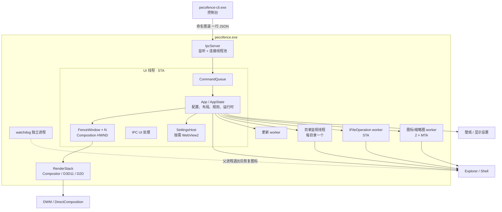

# PecoFence 技术方案

| 项目 | 内容 |
|---|---|
| 文档版本 | 1.0 |
| 对应产品版本 | 0.2.3 |
| 对应产品需求 | [PRD.md](PRD.md) |
| 语言 / 构建 | Rust 2024 edition，最低 Rust 1.95，x86_64-pc-windows-msvc |
| 目标平台 | Windows 10 22H2、Windows 11 22H2 及以上，x64 |
| 更新日期 | 2026-10-31 |
| 许可 | Apache-2.0 |

## 1. 目标与约束

### 1.1 设计目标

1. **原生、轻量**：不引入 Electron/Tauri 式常驻前端；栅栏窗口与渲染走 Win32 + Direct2D + Windows.UI.Composition，空转内存约 40 MB。
2. **虚拟归属优先**：整理默认只改变「图标显示在哪个栅栏」，不改动真实文件；真实文件操作走 Shell。
3. **桌面无缝集成**：栅栏贴在桌面图标宿主之上，支持 Win+D、快速隐藏、速览、每显示器 DPI 与独立布局。
4. **可控的玻璃渲染**：只采样壁纸，不读取其他窗口；Fluent 与 Liquid Glass 两套材质可切换，支持自定义主题。
5. **安全可恢复**：隐藏真实桌面图标是受控操作，正常退出、卸载、崩溃 watchdog、手动入口均可恢复。
6. **可被外部驱动**：CLI 与 AI 通过本机命名管道控制运行中的实例，协议版本化、输出 JSON、错误码稳定。
7. **可测试**：平台无关逻辑留在 `core`，可在任意平台单元测试；Windows 相关代码集中在 `platform`/`render`。

### 1.2 硬约束

- 仅 Windows；依赖 Win32/DWM/Composition/Direct2D/D3D11、Shell、OLE、WebView2（设置页）。
- 不申请常驻服务或驱动；桌面集成依赖 Explorer 的窗口层级与桌面图标开关。
- 不使用 Shell 扩展，因此没有桌面右键「配置 PecoFence」。
- 玻璃只采样当前壁纸，不支持视频壁纸或其他窗口内容。
- 发布构建静态链接 MSVC CRT（`+crt-static`），`panic = "abort"`，使用 fat LTO。

### 1.3 非目标

- 跨平台、云同步、账户体系。
- 多页桌面、Shell 命名空间扩展、窗口内容捕获。
- 后台遥测。

## 2. 总体架构

### 2.1 进程与组件



`pecofence-watchdog.exe` 是独立进程，不共享应用状态；它只在父进程异常退出、且桌面图标隐藏标记仍存在时执行恢复。

### 2.2 Crate 职责

| Crate / 目录 | 职责 | 关键约束 |
|---|---|---|
| `crates/core` | 平台无关数据模型、配置读写、规则引擎、几何归一化、日期分组、热键解析、i18n、更新元数据 | **不得依赖 Windows API**，可跨平台单测 |
| `crates/platform` | Win32、Shell、DWM、OLE、拖放、文件操作、命名管道、目录监视、合成时钟、托盘、菜单、崩溃日志、HTTP、显示语言检测 | 集中 `unsafe`；对上提供安全封装 |
| `crates/render` | Windows.UI.Composition 视觉树、Direct2D 绘制、壁纸采样、Fluent/Liquid Glass、GPU 玻璃、动效、主题、文字 | 不感知栅栏业务模型，只绘制输入 |
| `crates/app` | 窗口、输入、应用状态、命令队列、IPC UI 处理、设置 WebView2、托盘、监视器、速览 | 单 UI 线程拥有全部可变状态 |
| `crates/ipc` | 应用与 CLI 共享的线协议：方法、DTO、选择器、Schema 导出 | 不链接 GUI/WebView2 |
| `crates/cli` | 控制台前端：参数解析、管道客户端、JSON 输出、退出码、离线命令 | 只依赖 `ipc`/`core`，不依赖 `app` |
| `crates/watchdog` | 崩溃后恢复桌面图标 | 独立进程，重试有限次 |
| `tools/bindgen` | 生成 Win32 / Composition / GPU 玻璃绑定 | 生成物需与源一致，CI 校验 |
| `ui/` | 离线设置页 HTML 与 i18n helper | 构建时嵌入可执行文件 |
| `locales/` | 原生与设置页共享翻译目录 | 键集必须一致 |
| `site/` | 静态产品网站 | 独立构建，不进入应用 |
| `vendor/` | 上游 `windows-composition` / `windows-canvas` 的最小补丁 | 保留许可证 |

### 2.3 依赖规则

```text
core  ←  ipc, cli, platform(部分), app, watchdog
platform ← app, render(少量 d2d)
render ← app
ipc ← app, cli
cli  ← 不依赖 app/render/platform GUI
```

- `core` 是最底层，不能反向依赖 UI 或 Windows。
- `ipc` 是应用与 CLI 的唯一共享契约；CLI 不链接 GUI，因此不需要 WebView2 与图形栈。
- `render` 通过 `windows-composition` / `windows-canvas` 封装访问 Composition、D3D11、Direct2D；少量底层访问集中在 `comp`、`gpu_bindings`。
- `app` 持有 `AppState`，所有窗口与配置修改只在 UI 线程发生。

## 3. 进程生命周期

### 3.1 单实例

1. 读取 `PECOFENCE_INSTANCE`；为空表示默认实例。
2. 依次获取当前实例名与旧版实例名的命名互斥体；任一被占用则退出。
3. 若重复启动且没有额外参数，通过管道向运行实例发送 `settings.openUi`，而不是静默退出；运行实例启动不足 30 s 时不打开设置，避免登录时两个自启动条目竞争。
4. 测试实例使用 `--portable` + 独立 `PECOFENCE_INSTANCE` + 独立目录，互不干扰日志、配置与图标状态。

### 3.2 启动顺序（三阶段异步流水线）

原方案中 App::create 同步串行抓取壁纸、初始化着色器与切换图标会导致 UI 线程阻塞。重构为三阶段异步启动流水线：

`	ext
阶段一：极速上屏 (Stage 1: Fast Surface, < 200 ms)
  1. 解析参数、获取实例互斥体、初始化日志、安装 panic/崩溃处理
  2. 设置 Per-Monitor DPI Awareness V2、OLE 初始化
  3. App::create: 加载配置（主 → .bak → 每日备份 → 默认）
  4. 解析当前显示器与工作区、匹配/创建布局、恢复栅栏与项目
  5. 创建各 Fence HWND，挂载基础 Composition 视觉树
  6. 以单色 Acrylic / 低算力纯色面板作为临时底色上屏 (Skeleton UI)
  7. 启动托盘、图标缓存、文件 watcher（进入开机静默模式）、IPC 服务
  8. 注册速览热键、启动 Win32 消息循环 —— 窗口立刻具备移动、缩放与点击响应

阶段二：后台异步就绪 (Stage 2: Background Priming, 异步 Worker)
  1. Worker 线程池异步提取当前屏幕壁纸并构建 MonitorBackdrop
  2. 预编译/上传 Liquid Glass 折射网格与 GPU 材质管线
  3. 异步探测桌面项目基本信息，生成初始网格占位；图标 MTA worker 仅优先提取视口可见区域项目
  4. 通过 WM_APP_STARTUP_BACKDROPS 投递回 UI 线程，执行 167 ms 平滑渐变替换

阶段三：延迟系统集成 (Stage 3: Delayed Desktop Hook, +1.5 s ~ 2.5 s)
  1. 避开 Explorer 开机风暴，通过 TIMER_HIDE_ICONS_DELAYED 异步触发 request_hide_desktop_icons
  2. 写入桌面接管 marker 标记并通过 WM_COMMAND 0x7402 隐藏桌面原生图标
  3. 30 秒后 TIMER_BOOT_SILENT_END 触发，恢复目录监视器常规灵敏度
`

**启动阶段细粒度日志**：App::create 各子阶段以 	racing::info!(stage=..., elapsed_ms=...) 打点。关键阶段：config_load、monitor_parse、window_create、skeleton_visible、worker_start、ackdrop_ready、hide_icons_start。

**降级策略**：若壁纸采样超时或 GPU 负载过高，栅栏以纯色背景呈现；壁纸稍后就绪时平滑切换。Liquid Glass 不可用时自动降级为 Fluent 简单模糊。

### 3.3 退出与崩溃

- 正常退出：`App::shutdown()` 保存配置、停止线程、恢复图标（`keepIconsHidden` 除外）。
- 更新：安装版下载 setup 后退出；setup 等待进程结束、安装并重新启动应用；恢复图标依赖卸载/安装流程与标记。
- 崩溃：panic hook 写日志与回溯；进程 abort；`watchdog` 检测父进程退出与标记文件，重试最多 10 次恢复图标；若新实例已接管则不处理。
- 日志：`%LOCALAPPDATA%\PecoFence\pecofence.log`，上次运行保留为 `pecofence.prev.log`；日志被占用无法重命名时改为复制或追加。可分享日志独立轮转。

### 3.4 线程模型（优化后）

| 线程 / 进程 | 优化前行为 | 优化后规范 |
|---|---|---|
| **UI 线程（STA）** | 在处理某些项目或规则时同步调用 Win32 文件元数据 API | **零同步磁盘 I/O**。任何路径存在性验证、软链接解包（IShellLink）、文件大小/时间计算必须通过异步任务池执行并回调。STA 消息队列单次处理时间不得超过 16 ms（60 FPS 基础响应） |
| IPC 监听线程 | 创建管道实例、接受连接 | 连接线程池，行为不变 |
| IPC 连接线程 | 读一行请求、写一行响应、超时取消 I/O | PendingQueue + WM_APP_COMMAND，行为不变 |
| **文件监视 (Watcher)** | 开机即以 60 ms 窗口合并事件向 UI 发送 WM_APP_FS_CHANGED | **分段节流策略**：启动首 30 秒（oot_silent = true）采用 1000 ms 合并窗口 + 2000 ms 风暴抑制，并主动过滤 .tmp、.crdownload、.part、.partial、.download 等已知临时扩展名；30 秒后由 TIMER_BOOT_SILENT_END 恢复为 60 ms / 400 ms |
| **图标 Worker (MTA)** | 集中在启动阶段爆发式读取图标 | **视口优先 (Viewport-First)** 调度：仅优先提取处于视口可见区域内的项目图标，折叠栅栏及非活动标签页内项目图标降级为低优先级异步排队队列 |
| 文件操作 worker（STA） | IFileOperation 移动/复制/删除/重命名 | 完成后投递命令并刷新，行为不变 |
| 更新 worker | 检查 release、下载 setup | WM_APP_COMMAND，行为不变 |
| **帧时钟 (FrameClock)** | 仅依赖全局动画标记 | **带超时自毁的空闲检测**：动画结束后的第 2 帧强制解除（disarm）合成时钟侦听；增加连续 500 ms 空闲唤醒检测，若没有任何 
equest() 重入则强制注销时钟，释放 CPU 占用 |
| watchdog 进程 | 父进程退出后恢复图标 | 文件标记 + 进程句柄，行为不变 |

**总原则**：UI 线程不做阻塞文件 I/O、不等待管道、不下载；所有跨线程结果通过窗口消息回到 UI 线程，避免锁顺序问题。启动阶段特殊处理见 [3.2 启动顺序](#32-启动顺序三阶段异步流水线)。

## 4. 数据模型与持久化

### 4.1 配置结构

`config.json` 顶层（`crates/core/src/model.rs`）：

| 字段 | 类型 | 说明 |
|---|---|---|
| `$schema` | URL | 公开 Schema，供编辑器补全；应用忽略其值 |
| `schemaVersion` | u32 | 当前为 1；大于当前版本视为不兼容 |
| `settings` | `Settings` | 全局设置：语言、颜色模式、主题风格、图标大小、滚动/收起/速览/吸附/自动启动、图标样式、桌面路径 |
| `items` | `HashMap<ItemId, Item>` | 全局项目表，按 UUID 索引；跨栅栏共享 |
| `layouts` | `Vec<Layout>` | 每套显示器组合一套布局 |
| `rules` | `RuleSet` | 规则、默认目标、未命中策略、是否持续更新 |
| `undoLog` | `Vec<Assignment>` | 归属变更日志（有限用途） |
| `snapshots` | `Vec<Snapshot>` | 用户与自动布局快照，共上限 20 |

`Layout`：

- `fingerprint: Vec<MonitorIdentity>`：显示器标识（设备路径、GDI 名、工作区 DIP、DPI、物理分辨率）。
- `fences: Vec<Fence>`：栅栏及其几何、视图、外观、项目引用、标签关系。
- `shown: u64`：每次成为当前布局时递增；最大者即上次显示的布局。

**多显示器语义**：不同显示器组合有独立布局，但所有布局共享同一组栅栏、项目与标签关系；切换布局时把当前布局的栅栏状态带到目标布局，并套用目标布局的几何与收起状态。

### 4.2 核心对象

```text
Config
 ├─ Settings
 ├─ Item { id, key, origin, display_name, file_id, mtime, is_folder, attrs,
 │         icon_key, orphaned_since, size, open_count, last_opened, path }
 ├─ Layout
 │   └─ Fence { id, title, kind, source, geometry, rolled_up, expanded_h,
 │              view, appearance, exclude_from_quick_hide, locked,
 │              tab_host, active_tab, tab_order, portal_navigate,
 │              open_folders_inside, hide_title_icon, hide_when_empty,
 │              expand_upward, bottom_anchored, items: [ItemRef] }
 ├─ RuleSet { default_target, keep_updated, unmatched, list }
 └─ Snapshot { id, name, ts, layouts }
```

关键设计：

- **项目身份**：`ItemKey::Path` 使用小写化、规范化绝对路径；系统命名空间使用 `::{CLSID}` 形式的路径键。
- **图标缓存键**：按扩展名共享图标（`ByExt`）或按文件内容 + mtime（`ByContent`），避免 exe/lnk/文件夹自定义图标串味。
- **归属**：`ItemRef { item_id, manual_index, assigned_by: User | Rule(id) | Migration }`；`assigned_by` 是「手动放置优先」与撤销的基础。
- **标签**：`tab_host` 表示作为标签；`active_tab` 在宿主上记录当前标签；`tab_order` 记录标签条顺序，可把宿主自身排在任何位置。
- **几何**：`NormGeometry` 保存相对显示器工作区的 DIP 坐标与大小、工作区尺寸、锚点；显示器分辨率/缩放变化时按锚点重排。
- **外观覆盖**：`AppearanceOverride` 按栅栏覆盖色调、不透明度、标题颜色/字号、悬停标题、只染标题栏、标签色。
- **快照**：`Snapshot` 保存全部布局，不含设置、规则与真实文件状态。

### 4.3 配置读写

`ConfigStore`（`crates/core/src/config_store.rs`）：

**读取顺序**

1. 主文件 `config.json`；若存在但解析/校验失败，先改名隔离为 `config.unreadable-<date>-<secs>.json`（保留最近 5 份），避免下一次保存把损坏文件轮转成 `.bak` 后删除。
2. 回退 `config.bak`。
3. 回退 `backups/<YYYY-MM-DD>.json` 中最新可读者。
4. 回退默认配置。

读取时对杀毒/同步工具造成的短暂共享冲突做等待重试，避免误判为损坏。

**保存顺序**

```text
validate(cfg)
  → 序列化 pretty JSON
  → 写 config.json.tmp
  → fsync
  → 旧 config.json 轮转为 config.bak
  → rename(tmp, config.json)
  → 每日备份（每天最多一份，保留 7 天）
```

- 跨设备导致 rename 失败时回退为原地写，保证保存不因文件系统差异完全失败。
- `validate` 检查：`schemaVersion` 范围、每个布局栅栏数量 ≤64、每个布局至多一个 inbox（应用初始化时保证有一个）、几何数值有限、透明度在允许范围或为 0；超出 1–8192 DIP 的手工编辑尺寸在加载/导入时钳制。
- 保存失败返回给 UI / IPC `warning`，主操作不回滚；用户被告知磁盘状态可能未更新。

### 4.4 迁移与兼容

- 旧版的 `micaLike` / `solid` 背景值映射到 Acrylic；旧版云母/纯色配置自动兼容。
- 旧版 `Win+Space`、`Win+Shift+Space` 速览热键在加载时回退 `Ctrl+Alt+Space`（Windows 输入切换占用）。
- `UNUSED_SETTINGS` 中已规划但未启用的字段保留在文件中，CLI 与 Schema 隐藏，避免旧版本读取失败。
- 布局指纹兼容：设备路径 → EDID 型号 + 连接器 → GDI 名；旧文件只有 GDI 名也能匹配。
- 桌面路径迁移：`settings.desktopPath` 记录上次桌面位置；桌面移动到 OneDrive/其他盘时重新指向项目记录，不丢归属。

## 5. 桌面集成与窗口模型

### 5.1 桌面图标宿主与锚定

- 通过 Shell 窗口层级找到桌面图标宿主 `SHELLDLL_DefView`（可能位于 `Progman` 或 `WorkerW`），按操作系统世代与 Explorer 结构做能力检测。
- 栅栏是独立顶层 HWND，使用 `DesktopWindowTarget` 绑定 Composition 视觉树；通过 z-order 保持在图标宿主之上，同时不遮挡普通应用窗口（普通窗口激活时栅栏自然退后）。
- 两种 z-order 模式：
  - `InsertAboveHost`：插入到图标宿主之上；
  - `HwndBottom`：置底，用于特定兼容场景。
- 监听 `WM_SETTINGCHANGE` / 显示设置 / 壁纸变化 / 桌面重建，重新解析宿主并重挂锚定。
- Win+D 检测：根据桌面显示/隐藏状态与 `ShowDesktopSetting` 决定栅栏保持可见或随桌面隐藏。

### 5.2 栅栏窗口

每个栅栏（非标签）拥有一个 HWND：

- 样式：`POPUP` + `THICKFRAME`（可缩放），扩展样式 `WS_EX_NOACTIVATE | WS_EX_TOOLWINDOW | WS_EX_NOREDIRECTIONBITMAP`。
- 永不激活：点击栅栏不抢前台焦点，避免打断用户当前应用。
- `DesktopWindowTarget` + `ContainerVisual`：窗口只承载 Composition 视觉树；Direct2D 内容画在 `CompositionDrawingSurface` 上。
- DWM 属性用于圆角/边框/阴影配合；阴影由独立 `ShadowWindow` 分层窗口绘制，alpha 与栅栏淡入淡出同步。
- 一个栅栏窗口的视觉树包含：
  - chrome（玻璃、圆角裁剪、标题行、标签条、强调色描边、折叠箭头、滚动条）；
  - content（图标/列表/详细信息、选中与悬停层、拖放目标高亮、插入标记）；
  - overlays（提示气泡、拖影预览、搜索框）。

标签宿主只保留宿主 HWND；被合并的栅栏不创建窗口，但保留几何供拆出。

### 5.3 桌面图标接管协议

```text
hide_desktop_icons:
  1. 写 marker 文件（记录本次接管）
  2. 通过 SHGetSetSettings 读取当前图标可见性
  3. 向桌面宿主发送 WM_COMMAND 0x7402 切换“显示桌面图标”
  4. 若未生效，重试/记录失败，避免重复切换
  5. keepIconsHidden 时另写 kept 标记供下次启动判断
```

- 读取用 `SHGetSetSettings(SSF_HIDEICONS)`；切换用 Explorer 自身的命令，不直接改注册表。
- 正常退出恢复；`keepIconsHidden` 时保留隐藏并写 kept 文件，下次启动接管。
- 崩溃时 watchdog 读取 marker；若 marker 仍存在且没有新实例接管，最多重试 10 次恢复。
- 安装版卸载时执行恢复；Store/便携版删除后需用户手动恢复（文档明确说明）。
- 所有入口幂等：已显示时再次恢复无副作用。

### 5.4 显示变化

- 监听显示设置、工作区、DPI 变化。
- 显示器热插拔后等待约 1 s 让显示集合稳定，再按指纹匹配布局，避免中间状态抖动。
- 每显示器独立 DPI 与工作区；登录时可能先以 96 DPI 报告，随后修正。
- 壁纸变化触发逐显示器 backdrop 重建；视频壁纸不参与采样。

## 6. 渲染架构

### 6.1 RenderStack

`RenderStack`（`crates/render/src/stack.rs`）是线程本地的渲染上下文：

- `DispatcherQueue`：驱动 Composition 动画与异步工作。
- `Compositor`：创建视觉树、动画、提交批次。
- `CompositionGraphicsDevice` + D3D11 `GpuDevice`：创建 `CompositionDrawingSurface`、上传位图、GPU 玻璃。
- WARP 软件回退：硬件设备不可用时仍可绘制。
- 设备丢失检测与重建：Direct2D/D3D11 设备丢失时重建 surface 与 brush，栅栏内容重绘。
- draw hook 与 GPU trim：绘制静默一段时间后释放 GPU scratch 内存。

### 6.2 绘制单元：Panel

`Panel`（`crates/render/src/panel.rs`）= `SpriteVisual` + `CompositionDrawingSurface`：

- surface 以物理像素分配，绘制会话应用 DPI 变换，业务代码以 DIP 绘制。
- 全量重绘，`BeginDraw`/`EndDraw` 成对；失败按设备丢失分类。
- `resize` 时若上一帧的 Composition commit batch 尚未结束，不直接 Resize surface（DirectComposition 会保留旧更新的 GPU 内存），而是换新 surface，旧 surface 在对应 commit 结束后释放。
- 裁剪通过 `Clip` 在 D2D 设备上下文上压入轴对齐裁剪，保证圆角/内容不溢出。

### 6.3 玻璃与壁纸

- **壁纸采样**：按显示器抓取当前壁纸，按缩放/填充模式映射到栅栏区域，缓存 `MonitorBackdrop`；壁纸变化或显示变化时重建。
- **Fluent**：模糊/着色壁纸作为毛玻璃；默认玻璃不透明度 55%；阴影 + 圆角裁剪 + 边缘线。
- **Liquid Glass**：按 kube.io Snell 折射模型在边缘弯折壁纸，16 DIP 圆角；GPU displacement/specular/effect graph 驻留，栅栏移动时只更新 transform；CPU 路径用于对比/回退。
- **自定义主题**：JSON → `CustomTheme`，基于 Fluent 或 Liquid Glass，覆盖模糊、色调、亮度混合、饱和度、噪点、折射、边缘高光、圆角、阴影、字体、强调色、颜色；文件热更新，错误时保持内置风格。
- 只采样壁纸，不读取其他窗口/视频，满足隐私与性能约束。

### 6.4 文字与多语言

- DirectWrite 文本布局；`windows-canvas` 补丁提供 `TextFormat::with_locale`，避免中文文件名被硬编码 `en-us` 渲染成日文字体。
- 字体可来自自定义主题（英文名或中文名）；未安装字体视为配置错误。
- 文本按 DIP 排版，图标标签最多 6 行，选中项展开。

### 6.5 动效

两套引擎（`crates/render/src/motion.rs`）：

| 引擎 | 用途 | 机制 |
|---|---|---|
| Composition 属性动画 | 视觉属性（偏移、缩放、透明度、玻璃边缘） | `Compositor` 动画 + commit batch |
| 客户端 Tween | Direct2D 内容（图标布局、滚动、标签条） | 每帧插值，`FrameClock` 与合成时钟对齐 |

- 时长 token：`FASTER = 83 ms`、`FAST = 167 ms`、`NORMAL = 250 ms`、`SLOW = 333 ms`。
- 曲线：decelerate / accelerate / point-to-point / collapse，按 WinUI/Fluent 规则。
- 系统「动画效果」关闭时，动画直接跳到终态。
- 帧时钟只在有动画时 armed；空闲时不产生唤醒，保证空转开销接近零。

## 7. 交互与文件操作

### 7.1 输入与命中测试

- 栅栏窗口使用自绘内容，命中测试按 DIP 网格计算图标 cell、标题行、标签、滚动条、折叠箭头、按钮热区。
- 选择模型：选中集合 + 焦点项；`Ctrl` 多选、`Shift` 范围、框选追加/反选；焦点项显示双层焦点环；非活动栅栏选中色转中性灰。
- 键盘：方向键/Home/End/PageUp/PageDown、首字母跳选、`Ctrl+A`、`Ctrl+Space`、`F2`、`Delete`、`Enter`、`F5`、`Alt+Enter`、菜单键/`Shift+F10`。
- 悬停：按系统 `SPI_GETMOUSEHOVERWIDTH/HEIGHT` 与悬停时间延迟显示提示气泡；滚动条热区不弹。
- 拖动滚动：靠近内容区上下边缘时逐帧加速自动滚动；框选越界同样自动滚动。

### 7.2 拖放

- 数据对象：`IDataObject` 使用 Shell 文件格式；拖出时调用 `IDropTargetHelper` 显示系统拖影与目标说明（`DropDescription`）。
- 小选区拖影：`DI_GETDRAGIMAGE` 获取按屏幕排布渲染的位图；大选区使用系统缩略图堆叠 + 数量角标。
- 修饰键语义：
  - `Ctrl` = 复制；
  - `Shift` = 移动；
  - `Alt` / `Ctrl+Shift` = 创建快捷方式；
  - 与来源允许的效果取交集；仅允许复制的来源按复制处理。
- 右键拖放：松手时弹出 Shell 风格菜单「移动/复制/创建快捷方式/取消」，默认项加粗，`Esc` 取消。
- 内部移动：虚拟栅栏之间只更新 `ItemRef` 归属与 `AssignedBy::User`；拖回桌面 = 归入「桌面」栏。
- 拖到文件夹图标或门户：调用真实文件操作。
- 外部拖入：文件真实移到桌面并归入目标栅栏；浏览器链接生成 `.url`。
- 拖到标签头：放入该标签；拖到同目录显示禁止光标。

### 7.3 文件操作与监听

- 使用 IFileOperation 在独立 STA worker 上执行，带进度/冲突/撤销；完成后通过 FileOpThen 触发门户刷新、桌面刷新、重命名或删除后的状态更新。
- UI 线程只发起请求与接收完成消息，不等待文件系统。
- 虚拟归属操作完全绕开 IFileOperation，因此无文件冲突、可瞬时完成。
- **快捷方式解析**：规则引擎匹配快捷方式目标（ShortcutTarget）时，只匹配已在后台缓存的目标路径，禁止在主线程实时调用 COM 接口解析 .lnk。IShellLink::Resolve 必须放到 MTA worker 上执行。
- **文件监视（Directory Watcher）**：

`	ext
文件系统变更事件到达
  |
  +-- 检查是否处于开机静默窗口 (boot_silent = true)
  |     |
  |     +-- 是（启动 < 30s）:
  |     |     debounce_delay = 1000 ms
  |     |     storm_max = 2000 ms
  |     |     临时文件过滤器丢弃: .tmp, .crdownload, .part, .partial, .download,
  |     |                        空扩展名, 以及 ~ 开头的文件
  |     |
  |     +-- 否:
  |           debounce_delay = 60 ms
  |           storm_max = 400 ms
  |
  +-- 聚合后的事件列表回传 UI 时:
        UI 线程仅更新内存中路径树，涉及重排计算（Relayout）标记为 dirty 并合批到下一垂直同步信号（VSync），
        避免连续触发 Panel 重绘
`

- Watcher 自愈机制不变（每分钟检查线程是否仍在运行，已死则重建）。
- oot_silent 状态由 App.boot_start: Instant 记录启动时刻，App.is_boot_silent() 返回 oot_start.elapsed() < Duration::from_secs(30)；同时由 TIMER_BOOT_SILENT_END（30 秒）超时解除，确保状态有界。

### 7.4 菜单、重命名与属性

- 项目右键使用原生 Shell 上下文菜单（`IContextMenu`），保留第三方扩展；栅栏/项目菜单为自绘，支持深浅色。
- 内嵌重命名编辑框：只选中主文件名，保留扩展名；`Enter` 提交、`Esc` 取消。
- 属性、打开所在位置、删除、复制/剪切/粘贴均映射到 Shell。
- 栅栏菜单包含视图、排序、新建、标签页、锁定、重命名、删除、栅栏选项等。

## 8. 规则引擎

### 8.1 数据结构

```text
RuleSet { default_target, keep_updated, unmatched: ReturnToInbox | Stay, list: Vec<Rule> }
Rule { id, name, enabled, target, all_of: Vec<Cond>, priority_class, template }
Cond = Type | Ext | ExactName | Name | Glob | ShortcutTarget | FoldersOnly | FilesOnly
     | PlainFiles | SizeMb | CreatedTime | CreatedWeekday | Origin | IdleDays
```

### 8.2 评估流程

```text
新项目 / rule apply
  → 忽略临时文件、系统项、desktop.ini、namespace 项
  → 过滤 enabled 规则
  → 快捷方式目标类规则优先（稳定排序）
  → 按顺序取第一条所有条件均为真的规则
  → 命中：设置归属，AssignedBy::Rule(id)
  → 未命中：按 unmatched 策略回「桌面」栏或留在原栏
```

- 手动拖放设置 `AssignedBy::User`；后续规则不再搬走。
- `RuleSet::default_presets()` 提供「程序与快捷方式」「文件夹」「文件与文档」三条预设。
- 「普通文件」条件用于收尾：扩展名未知的文件也算普通文件。
- 规则目标不能是门户；目标解析复用 CLI 选择器（UUID/前缀/标题/`inbox`）。
- 批量应用规则时若移动 ≥20 个桌面项目，先自动保存布局快照。

### 8.3 时间与身份条件

- 创建时间、星期、大小、闲置天数基于项目元数据与 `open_count`/`last_opened`。
- 临时文件在稳定前不参与（约 60 s 的 settle 窗口），避免下载中的文件被反复归类。
- 规则只改变归属；真实文件移动由用户显式操作或门户操作触发。

## 9. IPC 与 CLI

### 9.1 传输与访问控制

- 管道名：`\\.\pipe\PecoFence.<当前账户 SID>[.<实例名>]`。
- DACL 仅允许 `SYSTEM`、`Administrators`、当前用户；同一账户的其他会话（如 SSH）也能连接，其他账户不能。
- 一个连接承载一行 JSON 请求与一行 JSON 响应，`\n` 结尾。
- 请求上限 1 MB；超长拒绝为 `usage`。

### 9.2 协议

```json
{"protocol":1,"timeoutMs":15000,"method":"fences.list","params":{}}
```

```json
{"ok":true,"result":[...]}
```

- `protocol` 必须为 1；不匹配返回 `version_mismatch`。
- `timeoutMs` 是客户端等待上限；服务端在请求到达 UI 线程时若已超过截止时间，直接丢弃，**不执行**，避免 AI 重试造成重复操作。
- `Response`：`ok`、`result`、`error`、`warning`；`warning` 表示主操作成功但次要步骤（如保存配置）失败。
- 方法按域分组：

| 域 | 方法 |
|---|---|
| 只读 | `status.get`、`monitors.list`、`fences.list/get`、`items.list`、`settings.get`、`rules.get`、`snapshots.list`、`backups.list` |
| 栅栏 | `fences.create/delete/rename/setBounds/moveToMonitor/setOption/fit/roll/dockTop/merge/detach/setVisible/openOptions` |
| 项目 | `items.move/planMove/rename` |
| 设置/规则/快照 | `settings.patch`、`rules.set/add/remove/enable/move/apply`、`snapshots.save/restore/delete` |
| 配置 | `config.export/import`、`backups.restore` |
| 其他 | `peek.start/end`、`settings.openUi`、`events.subscribe` |

- 修改方法（`is_mutation`）在成功响应前保存配置；只读、干跑与打开 UI 不保存。
- 选择器：完整 UUID、≥6 位唯一前缀、标题（精确优先，再唯一不区分大小写子串）；`inbox` 始终指「桌面」栏。
- 名称/标题/快照名：trim 后 1–256 字符。
- 破坏性操作自动快照：删除栅栏、应用规则（有变动）、一次移动 ≥20 个桌面项目、恢复快照/导入配置。
- 错误码：`not_running`、`timeout`、`busy`、`usage`、`version_mismatch`、`fence_not_found`、`ambiguous_fence`、`item_not_found`、`ambiguous_item`、`rule_not_found`、`snapshot_not_found`、`invalid_value`、`invalid_path`、`validation_failed`、`limit_reached`、`unsupported`、`internal`；CLI 映射退出码 0/1/2/3/4。

### 9.3 服务端线程

```text
PipeListener（始终保留一个等待实例）
  → 连接线程（最多 8 个）
      → 读请求（10 s deadline）
      → 校验 protocol/大小/JSON
      → PendingQueue.push(Pending { request, reply, arrived })
      → PostMessage(WM_APP_COMMAND)
      → 等待 mpsc 响应（客户端 timeout + 5 s grace）
      → 写响应（5 s deadline）
```

- 超过 8 个连接立即回 `busy`；最多 8 个 busy 回复在飞，进一步洪泛则直接丢弃，避免线程无限增长。
- 每个阻塞管道操作都有 `IoDeadline`；连接后不发送、不读取的客户端会被取消 I/O 并释放槽位。
- 请求在 UI 线程执行；UI 处于菜单/文件对话框模态循环时可能延迟，超时后服务端丢弃而不是延迟执行。
- 事件流：`events.subscribe` 后连接进入流模式；每 500 ms 差分一次，30 s 心跳；最多 4 条流；支持按栅栏和事件类型过滤。
- 监听线程停止：自连接唤醒 `ConnectNamedPipe` + 取消 I/O + join；连接线程 detached 并由 deadline 自限。

### 9.4 CLI

- `clap` 控制台程序，不链接 GUI/WebView2。
- 输出 JSON；`--fields` 只保留字段，`--ascii` 转义非 ASCII。
- `describe` 输出命令目录与 JSON Schema；`skill` 输出 AI 指南。
- 离线命令：`config check`、`paths`、`log -f`。
- 修改操作返回 `changed`；`item move --dry-run` 使用独立 `items.planMove` 方法，保证旧版应用返回 unknown method 而不是误执行。
- 重名文件真实移动时跳过并返回 `skipped` + warning，不弹资源管理器替换框。

## 10. 设置界面（WebView2）

### 10.1 生命周期

- 设置窗口按需创建；关闭即销毁 WebView2 与窗口，不常驻。
- 页面资源（`ui/settings.html`、`ui/i18n.js`）嵌入可执行文件，由设置宿主加载，不依赖网络。
- 用户数据目录按实例哈希隔离，避免测试实例污染正式设置。
- WebView2 运行时缺失时：设置不可用，应用其余功能正常，并给出安装提示。

### 10.2 消息桥

页面 ↔ 原生使用 JSON 字符串：

| 方向 | 消息 |
|---|---|
| 页面 → 原生 | `ready`、`patchSettings`、`setRules`、`action`（导入/导出/快照/反馈/更新/恢复图标等） |
| 原生 → 页面 | `state`（完整设置、规则、栅栏、语言、版本）、`toast`、`update` 等 |

- 所有设置修改经 UI 线程校验后写入 `AppState`，再保存配置；页面不直接写文件。
- 栅栏选项页与主设置页共用协议；打开某栅栏选项时高亮该栅栏。
- 设置页支持草稿、语言切换与窄窗口布局，浏览器测试使用 mock host bridge，不触碰运行中实例。

## 11. 性能与资源策略

| 机制 | 优化后设计 |
|---|---|
| 空闲内存 | 原生 Rust + Composition；设置页按需；空转约 40 MB（产品 README 数据） |
| **冷启动首帧 (TTI)** | 放弃启动同步全量渲染，采用骨架面板（Skeleton Panel），首帧上屏 ≤ 300 ms；HDD 环境 ≤ 1.5 s、SSD 环境 ≤ 600 ms 完成首屏骨架绘制并响应鼠标操作；高阶材质完全就绪时间 ≤ 2.5 s |
| 壁纸与玻璃 | 材质加载异步化，计算完成后淡入；若检测到 GPU 负载过高或显存不足，自动降级为 Fluent 简单模糊，避免 D3D 设备重置或丢帧 |
| 图标提取 | 2 个 MTA worker 异步提取；**视口优先调度**（见 §3.4）；UI 显示占位块；失败按 0.4/1.5/4 s 重试三次 |
| 文件操作 | 独立 STA worker，不阻塞 UI；完成消息回投 |
| **目录监视** | **分段节流**：启动首 30 秒（开机静默模式）1000 ms / 风暴 2000 ms + 临时文件过滤；之后恢复 60 ms / 400 ms；watcher 每分钟自愈 |
| 壁纸 | 逐显示器采样并缓存；变化时重建；视频壁纸不采样 |
| 显示变化 | 等待约 1 s 稳定后布局，避免中间态抖动 |
| **帧时钟 (FrameClock)** | **空闲零唤醒 + 自愈**：仅动画期间 armed；动画结束后第 2 帧强制解除；连续 500 ms 没有 
equest() 重入则强制注销时钟并 	racing::warn! 告警；空闲 CPU 占用率稳定在 0.1% 以下 |
| GPU 内存 | 面板 surface 退役延迟释放；绘制静默后 trim scratch |
| 事件流 | 仅在有订阅者时每 500 ms 差分；无订阅零开销 |
| 配置保存 | 防抖/定时保存；原子写；保存失败显式告警 |
| 启动阶段日志 | App::create 各子阶段以 	racing::info!(stage=..., elapsed_ms=...) 打点，便于定位同步阻塞点 |

**不以虚构指标作为验收**：除 README 已声明的约 40 MB 空转内存、TTI 约束（机械硬盘 ≤ 1.5 s，SSD ≤ 600 ms）、高阶材质就绪 ≤ 2.5 s、开机静默 30 秒、FrameClock 空闲 CPU < 0.1% 外，本方案不承诺未测量的启动时间、帧率或吞吐。

## 12. 工程化与质量保障

### 12.1 工作区与构建

- Rust workspace，`resolver = "3"`，edition 2024，最低 1.95。
- 统一依赖：`windows-core`/`windows-numerics`/`windows-window`/`windows-canvas`/`windows-composition`/`windows-webview` 0.100，serde/serde_json，uuid，tracing，clap，schemars。
- `.cargo/config.toml`：`target-feature=+crt-static`，静态 MSVC CRT。
- release：`opt-level=3`、fat LTO、`codegen-units=1`、`panic="abort"`、`strip=false`、`debug=line-tables-only`（PDB 不随包分发，供崩溃符号化）。
- dev：`opt-level=1`，兼顾编译速度与调试体验。

### 12.2 Unsafe 边界

- `unsafe` 集中在 `crates/platform` 与 `crates/render`；`app`/`core` 尽量使用安全封装。
- 工作区 lint：`unsafe_op_in_unsafe_fn = warn`；`undocumented_unsafe_blocks` 允许，但要求封装层注释清楚前置条件。
- `windows-bindgen` 生成的绑定集中在独立模块并允许 lint，避免手写 Win32 常量。

### 12.3 依赖补丁

- `vendor/windows-composition`：新增 `Visual::as_raw`、`Compositor::as_raw`（system stack），供渲染层访问包装器未暴露的 Composition API；上游提供等价访问器后可移除。
- `vendor/windows-canvas`：新增 `TextFormat::with_locale`，修复上游硬编码 `en-us` 导致 CJK 文件名使用日文字体。
- 分发时保留两个 vendored crate 的许可证。

### 12.4 测试与检查

| 检查 | 命令 / 位置 | 覆盖 |
|---|---|---|
| 格式 | `cargo fmt --all --check` | 全工作区 |
| Lint | `cargo clippy --workspace --all-targets -- -D warnings` | 全工作区 |
| 单测 | `cargo test --workspace` | 核心模型、规则、配置、几何、IPC、平台部分 |
| 绑定一致性 | CI 重新生成 bindgen 并 diff | Win32/Composition/GPU 绑定 |
| 翻译目录 | `python scripts/check-locales.py` | 键集、占位符 |
| README 翻译 | `python scripts/check-readme-translations.py` | 语言链接/结构 |
| 设置页 | `node scripts/test-settings-ui.mjs` | 语言、草稿、窄窗口，mock bridge |
| 语言冒烟 | `python scripts/test-language-smoke.py` | 11 种语言经真实 IPC 保存 |
| CLI 冒烟 | `powershell -File scripts/cli-smoke.ps1` | 隔离实例的创建/移动/规则/快照/退出码 |
| 打包 | `python scripts/test-windows-packaging.py` | ZIP/安装包内容、二进制一致、安装/升级/卸载 |
| CI | `.github/workflows/ci.yml` | Windows Server 2022；构建、测试、打包、冒烟 |

- CI 使用 Windows Server 2022 作为 Windows 10 代理；真实桌面会话、多显示器、DPI、Shell 菜单与 Win+D 仍需人工验证。
- 测试实例约定：独立目录 + `--portable` + `--no-hide-icons` + 唯一 `PECOFENCE_INSTANCE` + 关闭自动启动；冒烟测试不触碰真实配置与桌面。

## 13. 构建、打包与分发

### 13.1 构建

```powershell
cargo build --locked
Copy-Item third_party/webview2/WebView2Loader.x64.dll target/debug/WebView2Loader.dll
./target/debug/pecofence.exe
```

- `WebView2Loader.dll` 在进程启动时导入，必须与 exe 同目录，即使不打开设置。
- `pecofence-watchdog.exe` 需随应用一起打包。
- 正式发布需 `WebView2` 运行时（Windows 11 通常自带）。

### 13.2 打包

- `scripts/make-windows.ps1`：分别构建 app/watchdog 与 CLI，生成内容一致的便携 ZIP 与 Inno Setup 安装包。
- `scripts/make-msix.ps1` + `packaging/msix/AppxManifest.xml`：Microsoft Store MSIX。
- Inno Setup 7 通过 `-Iscc` / `ISCC` / PATH / 常见安装位置发现；CI 使用固定 URL + SHA-256。
- 安装版按当前用户安装，带开始菜单项与卸载程序；安装时恢复/接管桌面图标由安装流程处理。
- 卸载不删除用户配置与备份；安装版卸载恢复桌面图标。
- ZIP/安装版未签名，可能触发 SmartScreen；Store 版由微软签名并自动更新。

### 13.3 更新

- 设置 → 关于 → 检查更新；仅用户点击时访问 GitHub releases API。
- 安装版：worker 下载 setup（上限 64 MB），校验后退出，setup 等待进程结束并安装，再启动应用。
- ZIP 版或 release 无 setup：打开 release 页面。
- Store 版：不显示更新控件，由 Store 管理。
- 正式版不接收预发布版本（如 `v0.2.0-beta.1`）。
- 测试实例可用 `PECOFENCE_UPDATE_URL=http://127.0.0.1:...`，仅回环地址；release JSON 上限 1 MB。
- 更新不做自有哈希校验：HTTPS 保护传输，setup 自行校验安装数据；失败则重新启动旧版本。

## 14. 安全、隐私与可靠性

### 14.1 本机访问控制

- 命名管道 DACL 仅 `SYSTEM`、`Administrators`、当前用户 SID。
- 不监听 TCP；`PECOFENCE_UPDATE_URL` 仅测试实例且仅 `127.0.0.1`。
- CLI 不要求管理员权限；其能力受当前用户文件系统权限限制。

### 14.2 隐私

- 无遥测。
- 反馈由用户主动发送到 Cloudflare Worker；限流每分钟 3 条；IP 只用于限流、不保存；用户文本清洗 `@`、`#123` 等提及。
- 可分享日志按设计只包含代码中固定的文字、数字与错误码；有源码扫描测试保证；发送前用户可查看。
- 日志可包含运行诊断信息，但可分享日志不包含用户文件名/路径/剪贴板。

### 14.3 数据可靠性

- 原子写 + `.bak` + 每日备份 + 损坏文件隔离 + 默认回退。
- 恢复/导入前自动快照；快照上限 20，自动快照不挤占用户快照。
- 配置保存失败显式告警，不静默假装成功。
- 桌面图标标记与 watchdog 双保险；卸载/手动恢复入口。

### 14.4 崩溃与诊断

- panic hook 记录位置、静态 payload 与回溯；格式化消息放 `detail`，可分享日志省略。
- 未处理异常安装崩溃处理器，记录异常码与 `module+rva` 调用栈，留下 `.dmp`。
- 日志轮转；上次运行日志保留供诊断。
- 更新/下载 worker 的 panic 不会 unwrap I/O；release 配置 panic=abort，线程内禁止 unwrap。

## 15. 风险与技术债

| 风险 | 影响 | 缓解 |
|---|---|---|
| 依赖未公开的 Explorer 桌面宿主结构（Progman/WorkerW） | Windows 更新后锚定失效 | 运行时能力检测、世代差异处理、监听桌面重建、失败时回退/提示 |
| 依赖 `WM_COMMAND 0x7402` 切换桌面图标 | 系统行为变化导致隐藏失败 | 先用 `SHGetSetSettings` 读状态、失败重试、标记 + watchdog + 手动恢复 |
| Win+D / 显示桌面行为差异 | 栅栏显示策略异常 | 设置项（保持可见/随桌面隐藏）+ 运行时检测 |
| Composition/D3D 设备丢失 | 栅栏黑屏/崩溃 | 设备丢失分类、WARP 回退、重建 surface/brush、重绘 |
| Liquid Glass GPU 开销 | 低端设备掉帧 | GPU 路径 + CPU 对比/回退；只采样壁纸；空闲 trim |
| WebView2 缺失 | 设置不可用 | 按需加载；缺失时提示；应用其余功能不受影响 |
| vendored windows 包装器 | 上游更新/许可证维护 | 补丁最小化、保留许可证、上游等价后移除 |
| 大量真实文件操作 | UI 卡顿/数据冲突 | STA worker、系统进度/冲突/撤销、CLI 干跑、批量快照 |
| 配置格式演进 | 旧版本读不了新字段/字段被忽略 | `schemaVersion`、兼容映射、保留未启用字段、`$schema`、导入校验 |
| 测试矩阵有限 | 特定 Windows/DPI/多屏问题漏测 | CI + 隔离端口/实例测试 + 发布前人工矩阵 |
| 隐藏图标的安全边界 | 用户桌面不可用 | 默认只在使用栅栏时隐藏；正常/卸载/崩溃/手动四重恢复；文档明确 Store/便携版手动恢复 |
| 未定义产品决策（见 PRD Q-01…Q-07） | 异常路径不一致 | 在 PRD 中标记 TBD，实现前需产品确认 |

## 16. 关键代码索引

| 路径 | 作用 |
|---|---|
| `crates/app/src/main.rs` | 进程入口、单实例、日志、panic/崩溃处理、DPI/OLE、消息循环 |
| `crates/app/src/app/mod.rs` | `App` 状态、计时器、窗口/托盘/watcher/IPC/设置/更新/速览协调 |
| `crates/app/src/commands.rs` | UI 线程命令队列与 `WM_APP_*` 消息 |
| `crates/app/src/state.rs` | `AppState`、配置/布局、默认四栏、规则应用 |
| `crates/app/src/app/fences.rs` / `arrange.rs` | 栅栏创建/删除/布局/吸附/自动高度 |
| `crates/app/src/fence_window/` | 栅栏 HWND、视觉树、内容绘制、命中测试、行为参数 |
| `crates/app/src/anchor.rs` | 桌面宿主锚定、Win+D、快速隐藏、图标隐藏/恢复、watchdog 启动 |
| `crates/app/src/layout.rs` | DIP 图标网格、cell/间距/标签行高、滚动与命中 |
| `crates/app/src/icons.rs` | 图标/缩略图异步缓存、MTA worker、着色/Chameleon/快捷方式箭头 |
| `crates/app/src/app/dnd.rs` | 拖放、`IDropTarget`/`IDataObject`、拖影、修饰键语义 |
| `crates/app/src/app/fileops.rs` | `IFileOperation` worker、完成后刷新 |
| `crates/app/src/app/tabs.rs` | 合并/拆出/重排/切换标签、标签插入空隙 |
| `crates/app/src/app/portals.rs` | 门户导航、刷新、watcher |
| `crates/app/src/app/items.rs` | 打开/重命名/删除/剪贴板/新建/属性/定位 |
| `crates/app/src/peek.rs` / `peek_search.rs` / `app/peek.rs` | 速览压暗层、搜索、热键、状态恢复 |
| `crates/app/src/settings_host.rs` | 按需 WebView2、嵌入资源、JSON 桥 |
| `crates/app/src/app/settings.rs` | 设置协议、导入导出、快照、主题指南 |
| `crates/app/src/app/sync.rs` | 桌面/公共桌面/门户 watcher 与自愈 |
| `crates/app/src/app/feedback.rs` | 反馈页、日志截取、系统事实 |
| `crates/app/src/app/updates.rs` | 更新检查/下载 worker、版本/渠道判断 |
| `crates/app/src/ipc_server.rs` | 管道监听、连接线程、超时、忙回复 |
| `crates/app/src/app/ipc.rs` | UI 线程 IPC 处理、事件差分、自动快照 |
| `crates/core/src/model.rs` | 配置/布局/栅栏/项目/快照/设置模型与几何 |
| `crates/core/src/config_store.rs` | 读取回退、原子保存、每日备份、隔离、校验 |
| `crates/core/src/rules.rs` | 规则数据结构、条件评估、预设 |
| `crates/core/src/geometry.rs` | 工作区、DPI、归一化几何 |
| `crates/core/src/i18n.rs` | 语言、翻译目录、回退 |
| `crates/platform/src/desktop.rs` | OS 世代检测、图标宿主解析、窗口辅助 |
| `crates/platform/src/shell_icons.rs` | 桌面图标可见性读取/切换、选中数 |
| `crates/platform/src/pipe.rs` | 管道监听、DACL、连接辅助 |
| `crates/platform/src/watcher.rs` | `ReadDirectoryChangesW` 目录监视 |
| `crates/platform/src/frameclock.rs` | 合成时钟 / `DwmFlush` 帧回调 |
| `crates/render/src/stack.rs` | `RenderStack`、设备、Compositor、WARP/设备丢失/trim |
| `crates/render/src/panel.rs` | `SpriteVisual` + `CompositionDrawingSurface`、DPI 绘制、surface 退役 |
| `crates/render/src/backdrop.rs` | 壁纸逐显示器采样、映射、模糊、着色 |
| `crates/render/src/liquid_glass.rs` | Snell 折射、bezel、dispersion、GPU/CPU 实现 |
| `crates/render/src/gpu_glass.rs` | 共享壁纸纹理与驻留 GPU 玻璃图 |
| `crates/render/src/motion.rs` | Composition 动画与客户端 Tween、令牌与曲线 |
| `crates/render/src/theme.rs` / `custom_theme.rs` | 内置主题、颜色、自定义主题 |
| `crates/ipc/src/lib.rs` | 请求/响应、方法、错误码、常量 |
| `crates/ipc/src/dto.rs` / `selector.rs` / `schema.rs` | DTO、选择器、Schema 导出 |
| `crates/cli/src/main.rs` | CLI 参数、管道客户端、输出与退出码 |
| `crates/watchdog/src/main.rs` | 父进程退出后恢复桌面图标 |
| `ui/settings.html` / `ui/i18n.js` | 设置页与桥接 |
| `locales/` | 11 种语言目录 |
| `scripts/` | 构建、打包、语言/CLI/打包/设置页测试 |
| `.github/workflows/ci.yml` | Windows CI |
| `packaging/inno/pecofence.iss` / `packaging/msix/AppxManifest.xml` | 安装版与 MSIX |

## 附录 A：线协议示例

**创建栅栏**

```json
{"protocol":1,"timeoutMs":15000,"method":"fences.create","params":{"title":"工作","rect":{"left":100,"top":100,"right":700,"bottom":500}}}
```

```json
{"ok":true,"result":{"changed":true,"fence":{"id":"…","title":"工作",…}}}
```

**超时与未运行**

```json
{"ok":false,"error":{"code":"timeout","message":"no reply within 15000 ms"}}
```

**事件流首包**

```json
{"ok":true,"result":{"subscribed":true,"fence":null,"events":["item.added","fence.changed"]}}
```

## 附录 B：关键常量

| 常量 | 值 | 位置 |
|---|---|---|
| `PROTOCOL_VERSION` | 1 | `crates/ipc/src/lib.rs` |
| `DEFAULT_TIMEOUT_MS` | 15 000 | 同上 |
| `MAX_REQUEST_BYTES` | 1 MB | 同上 |
| `BIG_MOVE_SNAPSHOT_ITEMS` | 20 | 同上 |
| `MAX_SUBSCRIBERS` | 4 | 同上 |
| `MAX_CONNECTIONS` | 8 | `crates/app/src/ipc_server.rs` |
| `READ_DEADLINE` / `WRITE_DEADLINE` | 10 s / 5 s | 同上 |
| `MAX_FENCES` | 64 | `crates/core/src/config_store.rs` |
| `DAILY_BACKUPS_KEPT` | 7 | 同上 |
| `UNREADABLE_KEPT` | 5 | 同上 |
| `MAX_SNAPSHOTS` | 20 | `crates/core/src/model.rs` |
| `SCHEMA_VERSION` | 1 | 同上 |
| `EVENT_TICK_MS` | 500 | `crates/app/src/app/ipc.rs` |
| 动画 token | 83 / 167 / 250 / 333 ms | `crates/render/src/motion.rs` |
| 拖放小选区阈值 | ≤4 项且 ≤320×320 DIP | `crates/app/src/app/dnd.rs` |
| 图标提取重试 | 0.4 / 1.5 / 4 s | `crates/app/src/icons.rs` |
| 文件变化合并 | 60 ms / 风暴 400 ms | `crates/app/src/app/mod.rs` |
| 显示变化稳定 | 1 000 ms | 同上 |
| Watchdog 恢复重试 | 10 次 | `crates/watchdog/src/main.rs` |

## 附录 C：与其他文档的关系

- 产品行为与业务规则：[PRD.md](PRD.md)
- 完整功能总表：[FEATURES.md](FEATURES.md)
- CLI 用户手册与命令细节：[CLI.md](CLI.md)
- 主题文件格式：[THEMES.md](THEMES.md)
- 多语言与翻译流程：[LOCALIZATION.md](LOCALIZATION.md)
- 开发、验证与架构摘要：[DEVELOPMENT.md](DEVELOPMENT.md)
- 打包与分发：[PORTABLE.md](PORTABLE.md)、[INSTALLER.md](INSTALLER.md)、[STORE.md](STORE.md)、[RELEASING.md](RELEASING.md)
